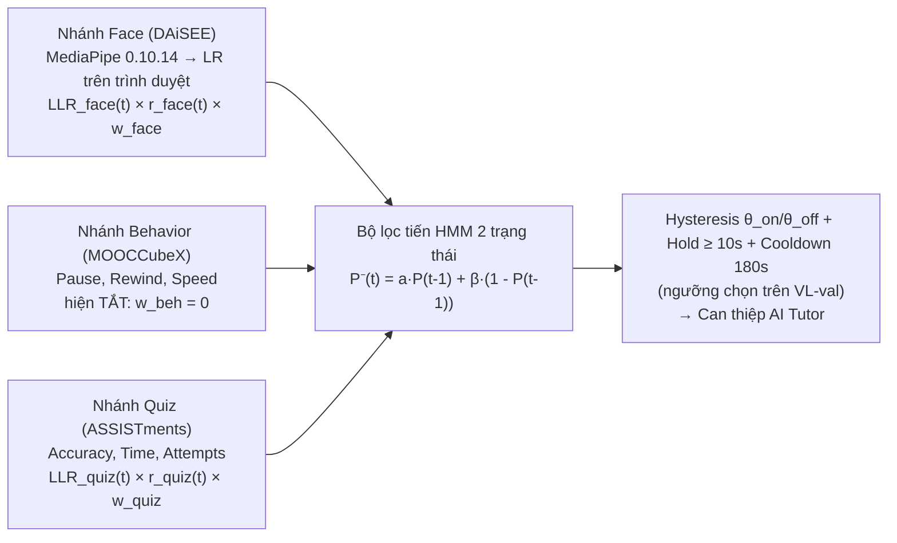

# ML Pipeline V2 — SP-BEF (Segment-Prior Bayesian Evidence Fusion)

Thư mục này chứa toàn bộ quy trình huấn luyện, hiệu chỉnh xác suất (Isotonic/Platt Calibration), xuất mô hình khuôn mặt (`sp_bef_face.onnx`, dùng để kiểm tra parity; trình duyệt đọc tham số từ `sp_bef_params.json`), giao thức đánh giá **Virtual Learner (C6)** và bộ kiểm thử tự động `pytest` (P7 Gate) cho hệ thống phát hiện bối rối đa phương thức chỉ sử dụng **100% Dữ liệu Mở Thực tế**.

> **Tài liệu liên quan**:
> - [`PLAN_V2_CONFUSION.md`](./PLAN_V2_CONFUSION.md): Thiết kế toán học và lộ trình kỹ thuật P0–P7.
> - [`NOVELTY_CHECK.md`](./NOVELTY_CHECK.md): Kiểm tra tính mới học thuật (2020–2026) và bảng ánh xạ đặc trưng 1-1 giữa Dataset mở $\leftrightarrow$ LMS Runtime.
> - [`REPORT_V2.md`](./REPORT_V2.md): Báo cáo kết quả thực nghiệm đầy đủ trên tập `test` chính thức (bao gồm các giới hạn thực tế).
> - [`data/MANIFEST.json`](./data/MANIFEST.json): Checksum `SHA256` của toàn bộ tập dữ liệu mở và mô hình MediaPipe `0.10.14`.

---

## 1. Kiến trúc SP-BEF



Prior theo đoạn video (`C3`) đang là prior đồng nhất (base rate). Dữ liệu mở không có nhãn bối rối theo đoạn nên C3 chưa kiểm chứng được.

---

## 2. Kết quả

Toàn bộ số liệu nằm trong [`REPORT_V2.md`](./REPORT_V2.md), file này được `run_sp_bef_pipeline.py` sinh tự động từ `models/sp_bef_params.json`. README không chép lại bảng số để tránh lệch với lần chạy mới nhất.

Nguồn khuôn mặt: video gốc DAiSEE được trích bằng `extract_daisee_video_frames.py` (10 fps) → `data/daisee_video_frames_10fps.npz`; nếu không có file này pipeline dùng lại bản ảnh tĩnh 5 frame/clip. Thử thêm 36 đặc trưng blendshape theo thời gian: val AUROC +0.018 nhưng CI 95% của chênh lệch (bootstrap theo người) là [−0.009, +0.047], chứa 0, nên **không** đưa vào model.

Lưu ý: số liệu của bản V2.0 (AUROC 0.737 / 0.846 / fusion 0.938) **không hợp lệ**. Bản đó dùng nhãn DAiSEE làm đặc trưng, sinh nhãn hành vi từ chính các đặc trưng, và lấy mẫu cân bằng lại tập DAiSEE. Lỗi đã được sửa ở V2.1, kèm test chặn tái phát (`tests/test_sp_bef.py`).

---

## 3. Tái lập Thực nghiệm & Kiểm thử Tự động

```bash
# Chạy toàn bộ pipeline: trích đặc trưng, huấn luyện, hiệu chỉnh, fusion, golden vectors & REPORT_V2.md
# Cần dữ liệu trong data/ (xem data/MANIFEST.json), gồm data/raw/mooccubex/{course.json, exercise-problem.txt, user-video.json, user-problem.head.json}
.venv/bin/python run_sp_bef_pipeline.py

# Chạy bộ kiểm thử cổng chất lượng P7 (pytest)
.venv/bin/pytest -v
```
