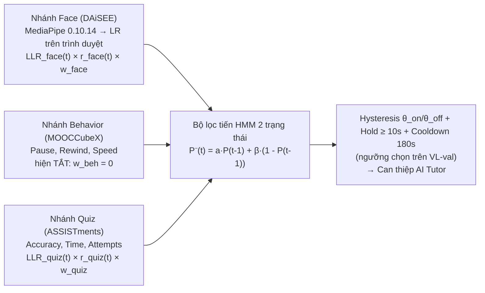

# ML Pipeline V2 — SP-BEF (Segment-Prior Bayesian Evidence Fusion)

Thư mục này chứa toàn bộ quy trình huấn luyện, hiệu chỉnh xác suất (Isotonic/Platt Calibration), xuất mô hình khuôn mặt (`sp_bef_face.onnx`, dùng để kiểm tra parity; trình duyệt đọc tham số từ `sp_bef_params.json`), giao thức đánh giá **Virtual Learner (C6)** và bộ kiểm thử tự động `pytest` (P7 Gate) cho hệ thống phát hiện bối rối đa phương thức chỉ sử dụng **100% Dữ liệu Mở Thực tế**.

> **Tài liệu liên quan**:
> - [`PLAN_V2_CONFUSION.md`](./PLAN_V2_CONFUSION.md): Thiết kế toán học và lộ trình kỹ thuật P0–P7.
> - [`NOVELTY_CHECK.md`](./NOVELTY_CHECK.md): Kiểm tra tính mới học thuật (2020–2026) và bảng ánh xạ đặc trưng 1-1 giữa Dataset mở $\leftrightarrow$ LMS Runtime.
> - [`GLOSSARY.md`](./GLOSSARY.md): Giải thích mọi ký hiệu (`LLR`, `r_*`, `w_*`, `contrib_*`, θ_on/θ_off, π_s, đặc trưng gaze…) kèm ví dụ số.
> - [`REPORT_V2.md`](./REPORT_V2.md): Báo cáo kết quả thực nghiệm đầy đủ trên tập `test` chính thức (bao gồm các giới hạn thực tế).
> - [`data/MANIFEST.json`](./data/MANIFEST.json): Checksum `SHA256` của toàn bộ tập dữ liệu mở và mô hình MediaPipe `0.10.14`.

---

## 1. Kiến trúc SP-BEF



Prior theo đoạn video (`C3`) đang là prior đồng nhất (base rate). Dữ liệu mở không có nhãn bối rối theo đoạn nên C3 chưa kiểm chứng được.

### Nhánh Gaze khi đọc (Reading View, đang thu dữ liệu)

Phiên bản chỉ-webcam của phần eye tracking trong Zhuang et al. 2025, *Detecting Reading-Induced Confusion Using EEG and Eye Tracking* (arXiv:2508.14442). Không có EEG. Webcam sai số ~4° (nhiều dòng chữ) và ~30 fps, nên **không** dùng đặc trưng theo dòng dọc hay theo thời lượng fixation.

- **Trình duyệt** (`lms-web/src/features/reading-gaze/`): iris MediaPipe (468–477) + yaw/pitch đầu → hồi quy ridge bậc 2, hiệu chuẩn 9 điểm + 4 điểm kiểm định → lọc One Euro → gán điểm nhìn vào đoạn → fixation I-DT (100 px) → bù trôi ngang theo điểm đáp của return sweep.
- **Đặc trưng mỗi đoạn** (`GAZE_FEATURES`): `dwell_ratio` (so với tốc độ đọc cá nhân), `reread_count`, `para_regression_rate` (quay về đoạn trước / 100 từ), `sweep_ratio` (return sweep / (số dòng − 1), > 1 là đọc lại dòng), `gaze_transition_entropy` (entropy chuyển tiếp theo 5 ô ngang, Krejtz et al. 2015), `saccade_rate`.
- **Độ tin cậy** `r_gaze = compute_gaze_reliability`: sai số hiệu chuẩn chia cho chiều cao đoạn trung vị (≤ 0.5 đủ trọng số, ≥ 1.5 bằng 0), tỉ lệ có mặt, tỉ lệ nhìn vào chữ, yaw. Trang gợi ý kiểm tra lại (4 điểm, ~7 s) sau 8 phút hoặc khi phần lớn điểm nhìn rơi ra ngoài chữ.
- **Fusion**: số hạng `r_gaze · w_gaze · llr_gaze` trong `sp_bef_step` (Python / TS / Go, parity qua `golden/gaze_parity_vectors.json`).
- **Hiện trạng**: nhánh **chưa huấn luyện** (`branches.gaze.trained = false`, LLR luôn 0) và **tắt** (`w_gaze = 0`). Prior theo độ khó văn bản (`segment_prior.reading_difficulty_slope`) cũng tắt.
- **Hai nguồn nhãn** (`POST /v1/student/confusion/reading-gaze` → bảng `reading_gaze_samples`, chỉ đặc trưng tổng hợp):
  - `designed_stimulus`: bài 199 "Bài đọc hiệu chuẩn theo dõi mắt", 12 đoạn theo cách tạo stimulus của bài báo: 4 đoạn mạch lạc (control = 0), 4 đoạn sai sự thật / xáo cụm từ (factual = 1), 4 đoạn thuật ngữ dày đặc (contextual = 1). Nhãn lấy từ thiết kế, không hỏi người đọc.
  - `self_report`: sau mỗi đoạn đọc xong, hỏi với xác suất cố định 0.5 (tối đa 4 lần/bài, cách nhau ≥ 45 s), **không phụ thuộc posterior của mô hình** để tập nhãn không lệch về các ca bị nghi ngờ.
- **Huấn luyện khi đủ dữ liệu** (≥ 200 mẫu, ≥ 15 người, chia theo người): xuất bảng ra JSONL/CSV (cột `user_id, label_source, stimulus_type, self_report_level, r_gaze` + 6 đặc trưng), rồi

```bash
.venv/bin/python 07_train_gaze_branch.py --logs reading_gaze_samples.jsonl [--label-source designed_stimulus]
```

Nhánh chỉ được bật (`w_gaze = 1`) khi CI 95% AUROC > 0.5 trên cả validation và test, cùng tiêu chí với các nhánh khác; AUROC test được báo riêng theo từng nguồn nhãn. Chạy lại `run_sp_bef_pipeline.py` vẫn giữ nguyên nhánh gaze.

---

## 2. Kết quả

Toàn bộ số liệu nằm trong [`REPORT_V2.md`](./REPORT_V2.md), file này được `run_sp_bef_pipeline.py` sinh tự động từ `models/sp_bef_params.json`. README không chép lại bảng số để tránh lệch với lần chạy mới nhất.

Nguồn khuôn mặt: video gốc DAiSEE được trích bằng `extract_daisee_video_frames.py` (10 fps) → `data/daisee_video_frames_10fps.npz`; nếu không có file này pipeline dùng lại bản ảnh tĩnh 5 frame/clip. Thử thêm 36 đặc trưng blendshape theo thời gian: val AUROC +0.018 nhưng CI 95% của chênh lệch (bootstrap theo người) là [−0.009, +0.047], chứa 0, nên **không** đưa vào model.

Lưu ý: số liệu của bản V2.0 (AUROC 0.737 / 0.846 / fusion 0.938) **không hợp lệ**. Bản đó dùng nhãn DAiSEE làm đặc trưng, sinh nhãn hành vi từ chính các đặc trưng, và lấy mẫu cân bằng lại tập DAiSEE. Lỗi đã được sửa ở V2.1, kèm test chặn tái phát (`tests/test_sp_bef.py`).

---

## 3. Tái lập Thực nghiệm & Kiểm thử Tự động

```bash
# Chạy toàn bộ pipeline: trích đặc trưng, huấn luyện, hiệu chỉnh, fusion, golden vectors & REPORT_V2.md
# Cần dữ liệu trong data/ (xem data/MANIFEST.json), gồm data/raw/mooccubex/{course.json, exercise-problem.txt, user-video.json, user-problem.head.json}
.venv/bin/python run_sp_bef_pipeline.py

# Chạy bộ kiểm thử cổng chất lượng P7 (pytest)
.venv/bin/pytest -v -rs

# data/ bị gitignore (~34 GB). Trên clone sạch, các test cần dữ liệu (MANIFEST, leakage, tái lập, nhãn DAiSEE/MOOCCubeX)
# được skip kèm lý do; các test chỉ dùng artifact (golden parity, bản sao params, edge case, core) vẫn chạy.
# SP_BEF_DATA_DIR=<thư mục> trỏ tới thư mục dữ liệu khác; SP_BEF_REQUIRE_DATA=1 biến skip thành lỗi.
SP_BEF_DATA_DIR=$(mktemp -d) .venv/bin/pytest -v -rs   # mô phỏng clone sạch

# Sinh lại edge-case vectors dùng chung cho Python / Go / TS (sau khi sửa ml/sp_bef/core.py)
.venv/bin/python export_sp_bef_edge_cases.py
```

Mức bối rối (`level`, giống nhau ở cả 3 runtime): `high` khi p ≥ θ_on, `moderate` khi θ_off ≤ p < θ_on, `mild` khi 0.6·θ_off ≤ p < θ_off, `none` khi thấp hơn, `unknown` khi mọi độ tin cậy bằng 0. Mốc `mild` cũ cố định 0.25 trùng với θ_off = 0.25 của tham số hiện tại nên `mild` không bao giờ xuất hiện.
