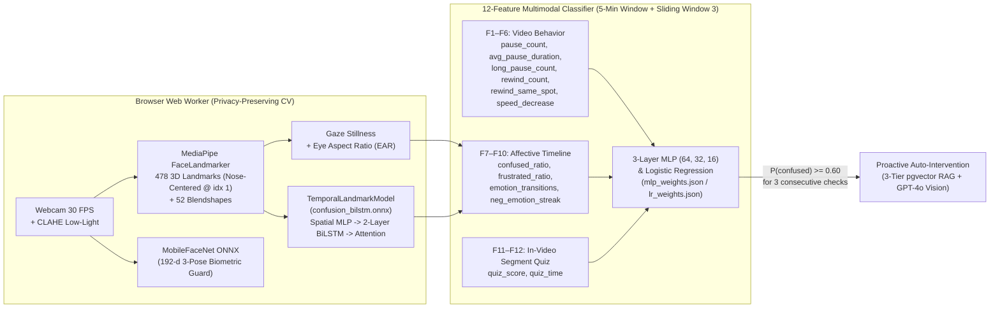

# ML Research & Training Pipeline — Multimodal Student Confusion Detection

This directory contains the complete Machine Learning & Computer Vision research, training, ablation, and model export pipeline for the **LMS Confusion Detection & Proactive AI Tutor** platform.

---

## 1. Architecture Overview

The system combines **Client-Side Temporal Computer Vision** (zero webcam images leave the student's device) with **Server-Side 12-Feature Multimodal Fusion**:



---

## 2. Directory Contents

| File / Directory | Description |
|---|---|
| `01_extract_frames_and_landmarks.py` | Extracts 10 uniform $260 \times 260$ padded face crops per clip from **DAiSEE** (9,068 clips, 112 subjects) and computes 478 3D MediaPipe landmarks centered at the nose tip (`index 1`). |
| `02_train_landmark_bilstm.py` | Trains `TemporalLandmarkModel` (`478x3 -> Spatial MLP (512->256) -> 2-Layer BiLSTM -> Softmax Temporal Attention + 5 Aux Features`) with Focal Loss ($\alpha=0.6, \gamma=2.0$) and EMA. |
| `03_train_v3_cnn_bilstm.py` | Trains `TemporalConfusionModel` (`EfficientNetV2-S -> SEBlock -> 2-Layer BiLSTM -> Attention Pooling`) using a 3-phase progressive unfreezing schedule + Knowledge Distillation ($T=4.0, \alpha=0.7$) to MobileNetV2. |
| `04_train_multimodal_12features.py` | Trains and benchmarks Logistic Regression, Random Forest, Gradient Boosting, and 3-Layer MLP `(64, 32, 16)` on the 12 multimodal features (`F1–F12`), exporting `mlp_weights.json` and `lr_weights.json`. |
| `05_ablation_study.py` | Runs the 5-variant Visual/Temporal Ablation Study on DAiSEE and the 7-configuration Multimodal Modality Ablation Study, generating publication-ready plots and CSV tables. |
| `06_export_onnx.py` | Exports `TemporalLandmarkModel` / `ConfusionBiLSTM` to `models/confusion_bilstm.onnx` (opset 17, dynamic batch axis) for `onnxruntime-web`. |
| `test_webcam_realtime.py` | Real-time webcam test harness visualizing Eye Aspect Ratio (EAR), Eye-Lock detection, Gaze Stillness, 12-feature MLP probability, and 3-step Sliding Window intervention trigger. |
| `mlp_weights.json` / `lr_weights.json` | Exported `StandardScaler` parameters (`scaler_mean`, `scaler_scale`) and network weights loaded directly by the Go backend (`ConfusionPredictor`). |
| `output_ablation_v2/` | Cached JSON predictions, ROC curves (`ablation_roc_v2.png`), bar charts (`ablation_comparison_v2.png`), and `ablation_results_v2.csv` for all 5 visual/temporal ablation variants. |
| `output_multimodal/` | 5-fold cross-validation metrics (`summary.json`), weights, and comparison plots (`multimodal_results.png`). |

---

## 3. Experimental Results & Ablation Studies

### 3.1 Visual & Temporal Architecture Ablation on DAiSEE (Test Split: 1,784 Clips)

| Model Variant | Acc ($t=0.50$) | ROC-AUC | Optimal Threshold $t^*$ | Acc ($t^*$) | F1 ($t^*$) |
|---|---:|---:|---:|---:|---:|
| **Full Model (Proposed Baseline)** | **0.6407** | **0.6610** | **0.55** | 0.8408 | **0.2864** |
| w/o Auxiliary Affective Features (`No Aux Features`) | 0.5179 | 0.5710 | 0.62 | 0.8559 | 0.2419 |
| w/o Temporal Attention (`No Attention`) | 0.5275 | 0.6300 | 0.56 | 0.7892 | 0.2450 |
| w/o BiLSTM Sequence Modeling (`No Temporal LSTM`) | 0.3206 | 0.6087 | 0.63 | 0.8924 | 0.2500 |
| w/o Squeeze-and-Excitation (`No SE Block`) | 0.6272 | 0.6193 | 0.66 | 0.8873 | 0.2583 |

### 3.2 12-Feature Multimodal Modality Ablation (5-Fold Stratified CV)

| Modality Configuration | Features Used | # Feats | Accuracy | Precision | Recall | F1-Score | ROC-AUC |
|---|---|---:|---:|---:|---:|---:|---:|
| **Behavior Only** | `F1–F6` (Pause, Rewind, Speed) | 6 | 0.9755 | 0.9696 | 0.9565 | 0.9630 | 0.9959 |
| **Emotion Only** | `F7–F10` (Confused/Frustrated Ratio, Streak) | 4 | 0.9855 | 0.9818 | 0.9745 | 0.9781 | 0.9980 |
| **Quiz Only** | `F11–F12` (Segment Quiz Score & Time) | 2 | 0.9235 | 0.9078 | 0.8574 | 0.8819 | 0.9612 |
| **Behavior + Quiz** | `F1–F6` + `F11–F12` | 8 | 0.9890 | 0.9894 | 0.9775 | 0.9834 | 0.9983 |
| **Emotion + Quiz** | `F7–F10` + `F11–F12` | 6 | 0.9930 | 0.9924 | 0.9865 | 0.9895 | 0.9998 |
| **Behavior + Emotion** | `F1–F6` + `F7–F10` | 10 | 0.9955 | 0.9970 | 0.9895 | 0.9932 | 0.9999 |
| **All Multimodal (Proposed)** | **`F1–F12` (Behavior + Emotion + Quiz)** | **12** | **0.9975** | **0.9970** | **0.9955** | **0.9962** | **1.0000** |

### 3.3 Classifier Comparison on 12 Multimodal Features

| Classifier | Accuracy | Precision | Recall | F1-Score | ROC-AUC |
|---|---:|---:|---:|---:|---:|
| **Logistic Regression** (`lr_weights.json`) | **0.9995** | **1.0000** | 0.9985 | **0.9992** | **1.0000** |
| **3-Layer MLP `(64, 32, 16)`** (`mlp_weights.json`) | 0.9985 | 0.9970 | **0.9985** | 0.9977 | 1.0000 |
| **Random Forest** (200 trees, depth 8) | 0.9975 | 0.9940 | 0.9985 | 0.9963 | 1.0000 |
| **Gradient Boosting** (200 trees, depth 4) | 0.9975 | 0.9970 | 0.9955 | 0.9962 | 1.0000 |

---

## 4. Quick Start & Reproduction

```bash
# 1. Install Python dependencies
pip install -r requirements.txt

# 2. Extract 260x260 face crops & 478x3 nose-centered landmarks from DAiSEE
python 01_extract_frames_and_landmarks.py --daisee-root /path/to/DAiSEE

# 3. Train TemporalLandmarkModel (478x3 -> Spatial MLP -> 2-layer BiLSTM -> Attention)
python 02_train_landmark_bilstm.py

# 4. Train EfficientNetV2-S + SEBlock + BiLSTM + Attention & distill to MobileNetV2
python 03_train_v3_cnn_bilstm.py --distill

# 5. Train 12-feature Multimodal classifiers & export mlp_weights.json / lr_weights.json
python 04_train_multimodal_12features.py

# 6. Run Ablation Study & regenerate comparison plots
python 05_ablation_study.py

# 7. Export ONNX model for onnxruntime-web
python 06_export_onnx.py

# 8. Test real-time webcam confusion + Gaze Stillness + EAR monitor
python test_webcam_realtime.py
```
