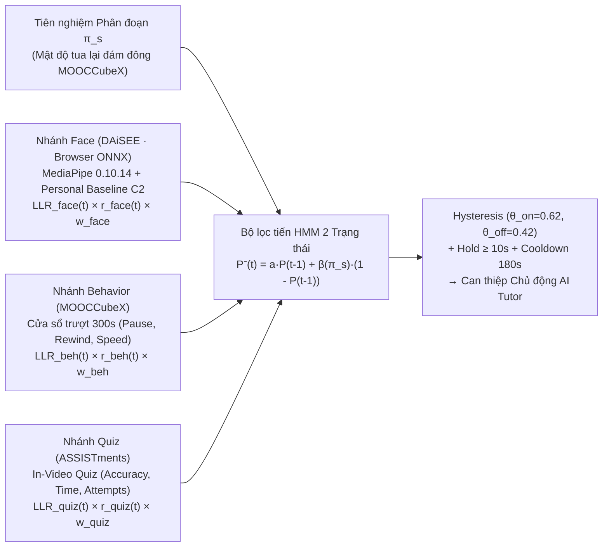

# ML Pipeline V2 — SP-BEF (Segment-Prior Bayesian Evidence Fusion)

Thư mục này chứa toàn bộ quy trình huấn luyện, hiệu chỉnh xác suất (Isotonic/Platt Calibration), xuất mô hình ONNX (`sp_bef_face.onnx`), giao thức đánh giá **Virtual Learner (C6)** và bộ kiểm thử tự động `pytest` (P7 Gate) cho hệ thống phát hiện bối rối đa phương thức chỉ sử dụng **100% Dữ liệu Mở Thực tế**.

> **Tài liệu liên quan**:
> - [`PLAN_V2_CONFUSION.md`](./PLAN_V2_CONFUSION.md): Thiết kế toán học và lộ trình kỹ thuật P0–P7.
> - [`NOVELTY_CHECK.md`](./NOVELTY_CHECK.md): Kiểm tra tính mới học thuật (2020–2026) và bảng ánh xạ đặc trưng 1-1 giữa Dataset mở $\leftrightarrow$ LMS Runtime.
> - [`REPORT_V2.md`](./REPORT_V2.md): Báo cáo kết quả thực nghiệm đầy đủ trên tập `test` chính thức (bao gồm các giới hạn thực tế).
> - [`data/MANIFEST.json`](./data/MANIFEST.json): Checksum `SHA256` của toàn bộ tập dữ liệu mở và mô hình MediaPipe `0.10.14`.

---

## 1. Kiến trúc SP-BEF (Segment-Prior Bayesian Evidence Fusion)



---

## 2. Kết quả Thực nghiệm Thực tế (Từ [`REPORT_V2.md`](./REPORT_V2.md))

### 2.1. Kết quả Từng Nhánh Đơn lẻ (Chia tách nghiêm ngặt theo Chủ thể `train ∩ val ∩ test = ∅`)

| Nhánh (Modality) | Tập dữ liệu mở | Số mẫu (`train / val / test`) | Chia tách (`Group Split`) | Base Rate $b_m$ | Test AUROC | Test AUPRC | Calibrated ECE ($\le 0.05$) | Brier Score |
| :--- | :--- | :--- | :--- | ---: | ---: | ---: | ---: | ---: |
| **1. Face Branch (w/o C2 Baseline)** | **DAiSEE** | `1732 / 493 / 530` clips | `68 / 19 / 21` subjects | `0.4729` | `0.7344` | `0.7555` | `0.0421` | `0.2063` |
| **1. Face Branch (+ C2 Personal Baseline)** | **DAiSEE** | `1732 / 493 / 530` clips | `68 / 19 / 21` subjects | `0.4729` | **`0.7367`** | **`0.7523`** | **`0.0422`** | **`0.2047`** |
| **2. Behavior + Segment Prior $\pi_s$** | **MOOCCubeX** | `9299 / 1425 / 1276` sessions | `1277` unique users | `0.3404` | **`0.8459`** | **`0.8320`** | **`0.0279`** | **`0.1471`** |
| **3. Quiz Branch** | **ASSISTments** | `54975 / 12904 / 12121` logs | `97` unique students | `0.1695` | **`0.7878`** | **`0.4563`** | **`0.0366`** | **`0.1153`** |

### 2.2. Đánh giá Hợp nhất SP-BEF & Ablation Study (Virtual Learner Protocol — 30% thiếu Camera, 60% thiếu Quiz, 25% Camera kém)

| Phương pháp / Cấu hình Ablation | Pointwise AUROC | Pointwise AUPRC | ECE $\downarrow$ | Brier $\downarrow$ | Độ trễ phát hiện $\downarrow$ | Can thiệp sai / giờ $\downarrow$ |
| :--- | ---: | ---: | ---: | ---: | ---: | ---: |
| `(a)` Luật cũ (`3 lần liên tiếp >= 0.60`) | `0.8768` | `0.8271` | `0.1613` | `0.1645` | `24.3s` | `0.10/h` |
| `(b)` Trung bình xác suất ngây thơ (`Naive Average`) | `0.8759` | `0.8162` | `0.1043` | `0.1446` | `3.8s` | `6.30/h` |
| `(c)` Logistic Stacking | `0.8931` | `0.8536` | `0.1574` | `0.1510` | `1.6s` | `9.60/h` |
| **`(d)` SP-BEF (Phương pháp Đề xuất Đầy đủ)** | **`0.9383`** | **`0.9131`** | **`0.0655`** | **`0.0979`** | **`7.2s`** | **`3.40/h`** |
| Ablation: Bỏ `C1` (Không khử Base-Rate LLR) | `0.9234` | `0.8949` | `0.0963` | `0.1182` | `11.9s` | `1.70/h` |
| Ablation: Bỏ `C2` (Không chuẩn hóa Baseline cá nhân) | `0.9355` | `0.9089` | `0.0724` | `0.1015` | `7.1s` | `3.30/h` |
| Ablation: Bỏ `C3` (Không dùng Prior đoạn video $\pi_s$) | `0.9376` | `0.9120` | `0.0876` | `0.1032` | `7.1s` | `3.70/h` |
| Ablation: Bỏ `C4` (Không dùng Trọng số tin cậy động $r_{\text{face}}$) | `0.9303` | `0.9016` | `0.0700` | `0.1046` | `7.2s` | `4.20/h` |
| Ablation: Bỏ `C5` (Không dùng HMM 2 trạng thái & Hysteresis) | `0.9036` | `0.8693` | `0.1405` | `0.1469` | `4.1s` | `3.10/h` |

---

## 3. Tái lập Thực nghiệm & Kiểm thử Tự động

```bash
# Chạy toàn bộ pipeline huấn luyện, hiệu chỉnh, xuất ONNX, tạo golden vectors & REPORT_V2.md
.venv/bin/python run_sp_bef_pipeline.py

# Chạy bộ kiểm thử cổng chất lượng P7 (pytest)
.venv/bin/pytest -v
```
