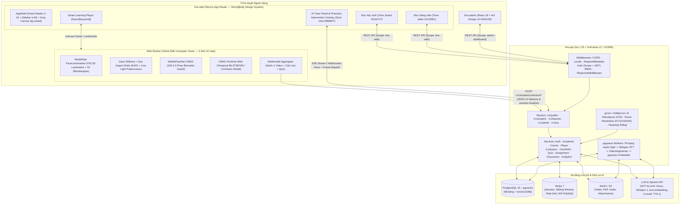

# MASTER PLAN — Hệ thống Học trực tuyến (LMS) Tích hợp Phát hiện Sự Bối rối qua Computer Vision & Trợ lý Ảo Giải thích Nội dung Thông minh

> **Đề tài:** Xây dựng hệ thống học trực tuyến tích hợp mô hình phát hiện sự bối rối của học sinh qua Computer Vision và trợ lý ảo giải thích nội dung thông minh.
> **Nguyên tắc kiến trúc & thiết kế cốt lõi:**
> 1. **Nghiệp vụ, Tính năng & Mô hình AI/CV:** Kế thừa toàn bộ 18 phân hệ chức năng, 58 bảng dữ liệu và pipeline AI/Computer Vision từ dự án mẫu **`LMS` (ALARMM)** (`/Users/hieu/Work/LMS`).
> 2. **Kiến trúc Backend (`lms-api`):** Tuân thủ 100% kiến trúc **Go + GoFrame v2 + GORM + PostgreSQL (`pgvector`) + Redis + `pgqueue`** của **`strongbody-api`** (`/Users/hieu/Work/strongbody-api`).
> 3. **Kiến trúc & UI/UX Frontend (`lms-web`):** Tuân thủ 100% kiến trúc **Next.js App Router (SSR-first)** và **Design System (`DESIGN_SYSTEM.md`, `tokens.css`, UI Kit)** của **`strongbody-web`** (`/Users/hieu/Work/strongbody-web`) — **tuyệt đối không học UI của dự án `LMS` cũ**.
> 4. **Kiến trúc Trang Quản trị (`lms-admin`):** Tuân thủ kiến trúc **React + Ant Design v5 (`#0A3150`) + Axios + TanStack Query + Redux** của **`strongbody_admin`** (`/Users/hieu/Work/strongbody_admin`).

---

## Mục lục

1. [Tổng quan Hệ thống & Ánh xạ Kiến trúc từ 4 Project Mẫu](#1-tổng-quan-hệ-thống--ánh-xạ-kiến-trúc-từ-4-project-mẫu)
2. [Kiến trúc Tổng thể & Cấu trúc Monorepo (`lms-confusion/`)](#2-kiến-trúc-tổng-thể--cấu-trúc-monorepo-lms-confusion)
3. [Hệ thống Thiết kế Giao diện (`lms-web`) — Học 100% từ `strongbody-web`](#3-hệ-thống-thiết-kế-giao-diện-lms-web--học-100-từ-strongbody-web)
4. [Chuẩn Kiến trúc Backend (`lms-api`) — Học 100% từ `strongbody-api`](#4-chuẩn-kiến-trúc-backend-lms-api--học-100-từ-strongbody-api)
5. [Chuẩn Kiến trúc Admin (`lms-admin`) — Học 100% từ `strongbody_admin`](#5-chuẩn-kiến-trúc-admin-lms-admin--học-100-từ-strongbody_admin)
6. [Thiết kế Cơ sở Dữ liệu Toàn diện (58 Bảng + `pgvector` từ `LMS`)](#6-thiết-kế-cơ-sở-dữ-liệu-toàn-diện-58-bảng--pgvector-từ-lms)
7. [Đặc tả Chi tiết 18 Module Nghiệp vụ & AI/CV (M1 – M18)](#7-đặc-tả-chi-tiết-18-module-nghiệp-vụ--aicv-m1--m18)
   - [M1. Xác thực, Hồ sơ Học thuật, Duyệt Giảng viên & Định danh Khuôn mặt (`auth`, `user`, `face`)](#m1-xác-thực-hồ-sơ-học-thuật-duyệt-giảng-viên--định-danh-khuôn-mặt-auth-user-face)
   - [M2. Cấu trúc Đào tạo Đại học & Import Excel Hàng loạt (`academic`, `import`)](#m2-cấu-trúc-đào-tạo-đại-học--import-excel-hàng-loạt-academic-import)
   - [M3. Quản lý Lớp học, Thời khóa biểu, Tính điểm GPA & Điểm danh AI Tự động (`classroom`, `schedule`, `attendance`)](#m3-quản-lý-lớp-học-thời-khóa-biểu-tính-điểm-gpa--điểm-danh-ai-tự-động-classroom-schedule-attendance)
   - [M4. Khóa học, Chương, Bài học, Phân đoạn Video (`VideoSegments`) & Đánh giá (`course`, `module`, `lesson`, `review`)](#m4-khóa-học-chương-bài-học-phân-đoạn-video-videosegments--đánh-giá-course-module-lesson-review)
   - [M5. Pipeline Xử lý Media, FFmpeg Whisper Transcription & `pgvector` RAG (`media`, `pgqueue`)](#m5-pipeline-xử-lý-media-ffmpeg-whisper-transcription--pgvector-rag-media-pgqueue)
   - [M6. Trình Học tập Thông minh (Smart Learning Player) & Chống Gian lận (`player`, `face-guard`)](#m6-trình-học-tập-thông-minh-smart-learning-player--chống-gian-lận-player-face-guard)
   - [M7. Mô hình Phát hiện Sự Bối rối Đa phương thức (Computer Vision + Hành vi + Quiz)](#m7-mô-hình-phát-hiện-sự-bối-rối-đa-phương-thức-computer-vision--hành-vi--quiz)
   - [M8. Trợ lý Ảo Giải thích Nội dung Thông minh (Multi-Modal Video RAG + Auto-Intervention + 3 Personas + Voice)](#m8-trợ-lý-ảo-giải-thích-nội-dung-thông-minh-multi-modal-video-rag--auto-intervention--3-personas--voice)
   - [M9. Hệ thống Quiz, Thi Thích ứng (Adaptive), Đấu trường Real-Time (WebSocket) & Gamification (`quiz`, `gamification`)](#m9-hệ-thống-quiz-thi-thích-ứng-adaptive-đấu-trường-real-time-websocket--gamification-quiz-gamification)
   - [M10. Bài tập (`Assignments`), Nộp bài Phiên bản, AI Chấm điểm Tự động theo Rubric & Quản lý Task (`assignment`, `submission`, `task`)](#m10-bài-tập-assignments-nộp-bài-phiên-bản-ai-chấm-điểm-tự-động-theo-rubric--quản-lý-task-assignment-submission-task)
   - [M11. Thảo luận Bài học (Cây bình luận Materialized Path) & Chat Trực tiếp 1-1 (`discussion`, `chat`)](#m11-thảo-luận-bài-học-cây-bình-luận-materialized-path--chat-trực-tiếp-1-1-discussion-chat)
   - [M12. Lộ trình Học tập Đồ thị DAG (`Roadmaps`), Lộ trình Cá nhân theo Học kỳ & Kế hoạch Học tập (`roadmap`, `study-plan`)](#m12-lộ-trình-học-tập-đồ-thị-dag-roadmaps-lộ-trình-cá-nhân-theo-học-kỳ--kế-hoạch-học-tập-roadmap-study-plan)
   - [M13. Analytics Học sinh, Analytics Giảng viên, Phát hiện Sinh viên Nguy cơ (`At-Risk`) & Báo cáo Hành vi AI (`analytics`, `teaching`)](#m13-analytics-học-sinh-analytics-giảng-viên-phát-hiện-sinh-viên-nguy-cơ-at-risk--báo-cáo-hành-vi-ai-analytics-teaching)
   - [M14. Tìm kiếm Toàn cục Lai (Hybrid Semantic + Full-Text Search) & Gợi ý Khóa học AI (`search`, `recommendation`)](#m14-tìm-kiếm-toàn-cục-lai-hybrid-semantic--full-text-search--gợi-ý-khóa-học-ai-search-recommendation)
   - [M15. Hệ thống Thông báo Đa kênh & Cron Nhắc học Thông minh (`notification`, `cron`)](#m15-hệ-thống-thông-báo-đa-kênh--cron-nhắc-học-thông-minh-notification-cron)
   - [M16. Hệ thống Quản trị (`lms-admin`)](#m16-hệ-thống-quản-trị-lms-admin)
   - [M17. Pipeline Huấn luyện Học máy & Thực nghiệm Khoa học (`ml/`)](#m17-pipeline-huấn-luyện-học-máy--thực-nghiệm-khoa-học-ml)
   - [M18. Hạ tầng Docker Compose, CI/CD & Kiểm thử](#m18-hạ-tầng-docker-compose-cicd--kiểm-thử)
8. [Danh mục Tổng hợp Toàn bộ API Endpoints (`/v1/*`)](#8-danh-mục-tổng-hợp-toàn-bộ-api-endpoints-v1)
9. [Lộ trình Triển khai Chi tiết theo Từng Giai đoạn (Phases)](#9-lộ-trình-triển-khai-chi-tiết-theo-từng-giai-đoạn-phases)

---

## 1. Tổng quan Hệ thống & Ánh xạ Kiến trúc từ 4 Project Mẫu

| Nguồn tham chiếu | Vai trò trong dự án mới | Những gì học & kế thừa | Những gì KHÔNG lấy |
|---|---|---|---|
| **`LMS` (ALARMM)** (`/Users/hieu/Work/LMS`) | **Mẫu Nghiệp vụ, Database & AI/CV** | • Toàn bộ **58 bảng CSDL** & **18 phân hệ** (Học vụ Khoa/Ngành/Học kỳ, Lớp học phần, Khóa học, VideoSegments 5–7 phút, Quiz thích ứng, Phòng thi đấu WebSocket, Bài tập & AI chấm điểm Rubric, Lộ trình DAG, Thời khóa biểu & Điểm danh AI tự động, Thảo luận cây, Chat 1-1).<br>• **Mô hình phát hiện bối rối đa phương thức:** MediaPipe 478 Landmarks / Gaze & Eye-Lock (EAR) + 12 đặc trưng đa phương thức (6 hành vi xem video + 4 cảm xúc + 2 quiz) + Sliding Window 3 + Cooldown 5 phút + MLP/LR predictor + Self-report 4 mức + Biometric Face Verification Guard (MobileFaceNet 3 góc mặt).<br>• **Trợ lý ảo thông minh:** 3-Tier RAG (`pgvector` + `VideoSegments` + transcript slice), **Proactive Auto-Intervention** (tự động dừng video & hiện giải thích + chips nội dung ngay khi bối rối), **Multi-Modal Video Frame Capture** (chụp khung hình bài giảng gửi GPT-4o Vision), **Hyper-Personalization** (theo Ngành/Năm học + 3 Persona: `socrates`, `coach`, `expert`), Voice Streaming (Whisper STT + TTS-1 chunking), Tóm tắt bài & Bản đồ khái niệm (`ConceptMap`). | **Không lấy** Flutter/Dart UI, không lấy Dart Frog backend. |
| **`strongbody-api`** (`/Users/hieu/Work/strongbody-api`) | **Mẫu Kiến trúc Backend (`lms-api`)** | • **Go 1.25 + GoFrame v2 (`gogf/gf/v2`) + GORM + PostgreSQL (`pgvector`) + Redis + `pgqueue` + `gcron` / `robfig/cron/v3`.**<br>• Phân tầng chuẩn: `api/<module>/v1/*.go` (`g.Meta` + `v:"..."`) $\rightarrow$ `internal/controller/<module>` $\rightarrow$ `internal/service` $\rightarrow$ `internal/repository` (`BaseRepository[T]`) $\rightarrow$ `internal/entity` (`BaseEntity`).<br>• Chuẩn `ResponseMiddleware` (`DefaultHandlerResponse{Code, Message, Data}`), mã lỗi 5 chữ số `utility/resCode`, `AuthenticationMiddleware` (kiểm tra header `Scope` + Bearer JWT), `AuthorizationMiddleware`, `PaginationDto` + `BuildWhere`, `internal/prompt` (`//go:embed`). | Không lấy nghiệp vụ y tế / thương mại điện tử (clinic, stripe, ga4, shop...). |
| **`strongbody-web`** (`/Users/hieu/Work/strongbody-web`) | **Mẫu Kiến trúc & UI/UX Frontend (`lms-web`)** | • **Next.js App Router (`src/app/[locale]/...`)**, SSR-first, `isMobileUserAgent`, `next-auth` (JWT auto-refresh + `AuthGate`), `next-intl` (chia file theo domain `messages/<locale>/<domain>.json`), Zustand (`src/store/*.ts`), `apiFetch`.<br>• **100% StrongBody Design System (`DESIGN_SYSTEM.md` & `tokens.css`):** Bố cục "Nền xám (`bg-muted` `#f9fafb`) + Card trắng (`cardVariants` `rounded-2xl border-line bg-white`, không bóng)", App Shell (`AppHeader` cố định `h-16` + `AppSidebar` cố định `w-65 shadow-side` có `NavSlide` chuyển chế độ Học sinh / Giảng viên), font duy nhất **Plus Jakarta Sans**, bộ icon duy nhất **Heroicons** qua `<Icon name="..." />` (`iconMap.ts`), `Dialog` (Catalyst Headless UI tự thành bottom-sheet trên mobile), `segmented` tab bar, và công cụ kiểm tra `npm run lint:ds`. | Không lấy nội dung marketplace mua bán dịch vụ y tế. |
| **`strongbody_admin`** (`/Users/hieu/Work/strongbody_admin`) | **Mẫu Kiến trúc Quản trị (`lms-admin`)** | • **React 18 + Ant Design v5 (`#0A3150`) + TanStack Query + Redux + Axios (`Scope: admin-dashboard`) + `@ant-design/charts`.**<br>• Bố cục `AppLayout` (`AppHeader`, `AppSidebar`), mẫu trang CRUD chuẩn (`PageTitle`, `ActionBar`, `FilterBar`, Antd `Table`, `Modal`, `Form`, xác nhận xóa). | Không lấy các route quản lý đơn hàng/sản phẩm y tế. |

---

## 2. Kiến trúc Tổng thể & Cấu trúc Monorepo (`lms-confusion/`)

### 2.1 Sơ đồ Kiến trúc Hệ thống



### 2.2 Cấu trúc Thư mục Dự án (`/Users/hieu/Work/lms-confusion`)

```text
/Users/hieu/Work/lms-confusion/
├── plan.md                             # Tài liệu kế hoạch tổng thể chi tiết này
├── docker-compose.yml                  # postgres(pgvector:pg16), redis:7, minio, lms-api, lms-web, lms-admin
├── Makefile                            # Lệnh chạy nhanh toàn bộ stack (dev, migrate, seed, lint, test)
│
├── lms-api/                            # BACKEND — Theo kiến trúc strongbody-api (Go 1.25 + GoFrame v2)
│   ├── main.go                         # Bootstrap DB, Redis, pgqueue consumer, cron schedulers, graceful shutdown
│   ├── go.mod
│   ├── Makefile
│   ├── Dockerfile
│   ├── .env.example
│   ├── manifest/config/config.yaml
│   ├── api/                            # Định nghĩa hợp đồng API (Req/Res structs + g.Meta + I<Module>V1)
│   │   ├── auth/                       # auth.go + v1/auth.go (login, register, refresh, forgot/reset, face)
│   │   ├── user/                       # user.go + v1/user.go (profile, academic profile, teacher-applications)
│   │   ├── academic/                   # academic.go + v1/academic.go (departments, majors, semesters, classes, imports)
│   │   ├── schedule/                   # schedule.go + v1/schedule.go (calendar, gpa, attendance, learning-log)
│   │   ├── course/                     # course.go + v1/course.go (courses, modules, lessons, segments, reviews)
│   │   ├── media/                      # media.go + v1/media.go (presigned upload, transcribe, extract-doc)
│   │   ├── confusion/                  # confusion.go + v1/confusion.go (predict, explain, log, self-report, analytics)
│   │   ├── tutor/                      # tutor.go + v1/tutor.go (stream-chat, voice-ws, summarize, concept-map, verify-watching)
│   │   ├── quiz/                       # quiz.go + v1/quiz.go (crud, adaptive, ai-generate, multiplayer rooms, leaderboard)
│   │   ├── assignment/                 # assignment.go + v1/assignment.go (assignments, submissions, ai-rubric-grade, tasks)
│   │   ├── discussion/                 # discussion.go + v1/discussion.go (comments tree, votes, mentions, chat 1-1)
│   │   ├── roadmap/                    # roadmap.go + v1/roadmap.go (course DAG, personal semester roadmap, study-plan)
│   │   ├── analytics/                  # analytics.go + v1/analytics.go (student dashboard, teacher hotspots, at-risk, nudge)
│   │   ├── notification/               # notification.go + v1/notification.go
│   │   └── admin/                      # admin.go + v1/admin.go (users, courses, imports, settings, stats, seed)
│   ├── internal/
│   │   ├── cmd/cmd.go                  # Server init, Swagger, CORS, ResponseMiddleware, /v1 group
│   │   ├── config/                     # Singleton env config (DbCfg, RedisCfg, JwtCfg, OpenAICfg, S3Cfg, ConfusionCfg)
│   │   ├── consts/                     # Scope constants ("lms-web", "admin-dashboard"), Role enums, Context keys
│   │   ├── controller/                 # Thin controllers implementing api/<module>.I<Module>V1
│   │   ├── service/                    # Business logic layer + ConfusionPredictor (MLP/LR) + TutorRAG + AttendanceEngine
│   │   ├── repository/                 # GORM data access layer (base.go + domain repositories)
│   │   ├── entity/                     # 58 GORM entities embedding BaseEntity + pgvector types
│   │   ├── dto/                        # PaginationDto, BuildWhere, Paginate, copier mapper, domain DTOs
│   │   ├── middleware/                 # authentication, authorization, cors, locale, request_metadata, response
│   │   ├── router/                     # route.go + sub-routers (public/, student/, teacher/, admin/, ws/)
│   │   ├── pgqueue/                    # Postgres pub/sub queue (queue_messages, queue_subscriptions, FOR UPDATE SKIP LOCKED)
│   │   ├── cron/                       # attendance_cron.go, notification_cron.go, heatmap_rollup_cron.go
│   │   ├── prompt/                     # //go:embed *.md (tutor_system.md, persona_socrates.md, persona_coach.md, persona_expert.md, explain_confusion.md, rubric_grade.md, behavior_report.md)
│   │   └── storage/                    # postgres/ (connection, migrate, seed) & redis/ & s3/
│   └── utility/
│       ├── resCode/resCode.go          # Mã lỗi 5 chữ số chuẩn StrongBody (400xx, 401xx, 403xx, 404xx, 500xx)
│       ├── token/                      # JWT generator & verifier
│       └── helper/                     # Slugify, Excel parser (excelize), FFmpeg wrapper
│
├── lms-web/                            # FRONTEND HỌC SINH & GIẢNG VIÊN — Theo kiến trúc & UI strongbody-web
│   ├── DESIGN_SYSTEM.md                # Quy tắc giao diện bắt buộc (kế thừa từ strongbody-web)
│   ├── package.json                    # Next.js App Router, Tailwind v4, next-auth, next-intl, zustand, @heroicons/react, onnxruntime-web, @mediapipe/tasks-vision
│   ├── scripts/design-system/lint.mjs  # Linter kiểm tra tự động không cho phép màu hex/px/font sai chuẩn
│   ├── messages/                       # Đa ngôn ngữ theo domain (vi/, en/)
│   │   ├── vi/ (app-shell.json, home-catalog.json, student-learn.json, ai-tutor.json, teacher-studio.json, ...)
│   │   └── en/ (...)
│   ├── public/
│   │   ├── models/                     # confusion_bilstm.onnx, mobilefacenet.onnx, mlp_weights.json
│   │   └── mediapipe/                  # face_landmarker.task, wasm files
│   └── src/
│       ├── styles/
│       │   ├── globals.css             # Tailwind v4 + import tokens, base, typography, utilities, sheet, focus
│       │   ├── tokens.css              # Bảng token chuẩn StrongBody (Plus Jakarta Sans, brand, seller, chat, muted, line...)
│       │   ├── typography.css          # text-display, text-h1..h4, text-body-lg, text-body, text-caption
│       │   ├── sheet.css               # Dialog tự chuyển thành bottom-sheet trên mobile < 728px
│       │   └── focus.css               # Focus ring xám trung tính (gray-500), không viền màu
│       ├── app/[locale]/
│       │   └── (lms)/                  # tương đương (HOME_CATEGORY) trong strongbody-web
│       │       ├── _shell/             # AppShell.tsx, AppHeader.tsx, DetailHeader.tsx, NavMenu.tsx, FlyBar.tsx, chrome.ts
│       │       ├── _components/
│       │       │   ├── ui/             # Button, ButtonLink, Card, Badge, segmented, chipVariants, PageHeader, Input, Select, EmptyState, LoadError
│       │       │   ├── primitives.tsx  # <Icon name="..." />, Avatar, Container
│       │       │   └── iconMap.ts      # Ánh xạ tên icon sang Heroicons outline/solid
│       │       └── (app)/
│       │           ├── page.tsx                        # Khám phá khóa học, Lộ trình nghề nghiệp, Gợi ý AI
│       │           ├── courses/[id]/                   # Chi tiết khóa học, Đề cương, Đánh giá, Lộ trình DAG
│       │           ├── search/                         # Tìm kiếm toàn cục (Khóa học, Bài giảng, Giảng viên)
│       │           ├── student/                        # Khu vực Học sinh (data-desktop-min-text, tone: brand)
│       │           │   ├── dashboard/                  # Tổng quan tiến độ, Chuỗi ngày học (Streak), Nhắc việc
│       │           │   ├── my-courses/                 # Khóa học đã ghi danh & Lớp học phần trường
│       │           │   ├── schedule/                   # Thời khóa biểu, Import Excel, Tính điểm mục tiêu GPA, Điểm danh
│       │           │   ├── tasks/                      # Quản lý công việc cá nhân & Bài tập về nhà
│       │           │   ├── quizzes/                    # Danh sách quiz, Thi thích ứng, Phòng đấu Multiplayer, Bảng xếp hạng
│       │           │   ├── roadmap/                    # Lộ trình học kỳ cá nhân & Kế hoạch học tập (Study Plan)
│       │           │   ├── analytics/                  # Heatmap học tập, Tốc độ học (Velocity), So sánh với lớp (Benchmark)
│       │           │   ├── achievements/               # Huy hiệu, Streak, Bảng điểm học tập (Transcript)
│       │           │   └── face-setup/                 # Đăng ký sinh trắc học 3 góc mặt (Thẳng, Trái, Phải)
│       │           ├── learn/[lessonId]/               # Màn hình Học tập Trung tâm (DetailHeader + Video + CV Worker + AI Tutor)
│       │           ├── ai-assistant/                   # Trợ lý AI toàn màn hình (Chat + Voice + Lịch sử)
│       │           ├── messages/                       # Tin nhắn trực tiếp 1-1 giữa Sinh viên & Giảng viên
│       │           └── teacher/                        # Khu vực Giảng viên (data-desktop-min-text, tone: seller #1C906C)
│       │               ├── dashboard/                  # Tổng quan giảng dạy, Sinh viên có nguy cơ (At-Risk) + Nút Nudge
│       │               ├── courses/                    # Quản lý khóa học, AI tạo cấu trúc khóa học, Trình biên tập Chương/Bài/Segment
│       │               ├── classes/                    # Quản lý Môn học, Lớp học phần, Import danh sách SV, Điểm danh AI/Thủ công
│       │               ├── assignments/                # Giao bài tập, Thu bài, Chấm điểm AI theo Rubric
│       │               ├── quizzes/                    # Ngân hàng đề, AI sinh câu hỏi từ Video/PDF/Ảnh, Tổ chức phòng thi
│       │               └── analytics/                  # Heatmap bối rối theo giây, Điểm nóng bài giảng, Báo cáo AI Data-Scientist, So sánh học kỳ
│       ├── features/
│       │   ├── confusion-cv/           # Web Worker MediaPipe + Gaze/EAR + MobileFaceNet Guard + ONNX BiLSTM + 12-Feature Logger
│       │   ├── ai-tutor/               # ConfusionInterventionOverlay, AiChatDrawer, PersonaSelector, FrameCapturer, VoiceStreamPlayer, ConceptMapModal
│       │   ├── video-player/           # SmartVideoPlayer (Anti-skip, SegmentQuizOverlay, VerifyWatchingModal, TimelineConfusionBar)
│       │   └── multiplayer-quiz/       # WebSocket client cho phòng thi đấu trực tuyến
│       ├── api/                        # Domain API modules dùng chung apiFetch (Scope: 'lms-web')
│       ├── store/                      # Zustand stores (learnStore, confusionStore, tutorStore, quizRoomStore, accountStore)
│       └── utils/device.ts             # isMobileUserAgent
│
├── lms-admin/                          # TRANG QUẢN TRỊ — Theo kiến trúc strongbody_admin (React 18 + Ant Design v5)
│   ├── package.json                    # react, antd v5.25, @ant-design/charts, @tanstack/react-query, redux, axios
│   └── src/
│       ├── App.js                      # ConfigProvider (primaryColor: '#0A3150') + Redux + QueryClient + Router
│       ├── utils/api.js                # Axios client (Scope: 'admin-dashboard', Bearer token cookie, 401/500 interceptors)
│       ├── layouts/                    # AppHeader, AppSidebar, AppDrawer, AppFooter
│       ├── components/                 # PageTitle, ActionBar, FilterBar, ExcelImportDropzone
│       ├── api/                        # users.js, academic.js, courses.js, applications.js, confusion.js, stats.js
│       └── routes/
│           ├── home/                   # Dashboard thống kê toàn hệ thống & biểu đồ
│           ├── users/                  # Quản lý Sinh viên / Giảng viên, Khóa/Mở tài khoản, Reset khuôn mặt
│           ├── teacher-applications/   # Duyệt hồ sơ đăng ký làm Giảng viên
│           ├── departments/            # Quản lý Khoa -> Ngành -> Học kỳ
│           ├── academic-courses/       # Quản lý Học phần & Lớp học phần (Gán giảng viên)
│           ├── bulk-imports/           # Import Excel hàng loạt (Sinh viên, Giảng viên, Ghi danh học phần)
│           ├── courses/                # Duyệt khóa học xuất bản, Quản lý đánh giá
│           └── ai-settings/            # Cấu hình ngưỡng Confusion, Cooldown, Giới hạn Token & Xem log hệ thống
│
└── ml/                                 # PIPELINE NGHIÊN CỨU & HUẤN LUYỆN AI/CV (Kế thừa từ LMS/scripts/confusion_model)
    ├── README.md
    ├── requirements.txt
    ├── 01_extract_frames_and_landmarks.py  # MediaPipe 478 3D Landmarks (nose-centered) & 260x260 face crops từ DAiSEE
    ├── 02_train_landmark_bilstm.py         # TemporalLandmarkModel (478x3 -> Spatial MLP -> 2-layer BiLSTM -> Attention + 5 Aux)
    ├── 03_train_v3_cnn_bilstm.py           # EfficientNetV2-S -> SEBlock -> BiLSTM -> Attention + Knowledge Distillation sang MobileNetV2
    ├── 04_train_multimodal_12features.py   # Huấn luyện LR, RF, GBDT, MLP (64,32,16) trên 12 đặc trưng (Hành vi + Cảm xúc + Quiz)
    ├── 05_ablation_study.py                # Thực nghiệm đối chứng 5 biến thể & xuất bảng kết quả NCKH
    └── 06_export_onnx_and_weights.py       # Xuất confusion_bilstm.onnx và mlp_weights.json / lr_weights.json
```

---

## 3. Hệ thống Thiết kế Giao diện (`lms-web`) — Học 100% từ `strongbody-web`

Toàn bộ giao diện `lms-web` tuân thủ nghiêm ngặt các quy tắc trong `strongbody-web/DESIGN_SYSTEM.md` và `strongbody-web/CLAUDE.md`:

### 3.1 Nguyên tắc Bố cục "Nền xám + Card trắng" & App Shell
1. **App Shell (`_shell/AppShell.tsx`)**:
   - **Header cố định (`AppHeader.tsx`)**: `fixed inset-x-0 top-0 z-50 h-16 border-b border-line-subtle bg-white/95 backdrop-blur-md` kèm `<div className="h-16 shrink-0" />` bên dưới. Bên phải giữ cố định `HeaderActionsHost` (Tìm kiếm nhanh, Chuông thông báo, Tin nhắn, Chuyển đổi Học sinh/Giảng viên, Menu tài khoản).
   - **Sidebar cố định trên Desktop (`NavMenu.tsx`)**: `fixed top-16 bottom-0 left-0 z-40 hidden w-65 flex-col overflow-y-auto bg-white shadow-side px-3 pt-3 pb-5 lg:flex`. Sử dụng hiệu ứng trượt ngang `NavSlide` để chuyển đổi mượt mà giữa:
     - **Menu Học sinh**: Khám phá · Khóa học của tôi · Thời khóa biểu & Điểm danh · Bài tập & Task · Đấu trường Quiz · Lộ trình học tập · Phân tích cá nhân · Thành tích & Huy hiệu.
     - **Menu Giảng viên (Teacher Studio)**: Tổng quan lớp · Quản lý khóa học · Lớp học phần & Điểm danh · Chấm bài tập (AI Rubric) · Ngân hàng Quiz · Phân tích Bối rối & Sinh viên Nguy cơ.
   - **Chế độ trang học bài (`DetailHeader.tsx`)**: Khi vào `/learn/[lessonId]` hoặc `/courses/[id]`, `chromeFor(pathname)` chuyển sang chế độ `'detail'` với nút Quay lại, tiêu đề bài học, tiến độ % khóa học, và chỉ báo trạng thái Camera AI.
2. **Nền Canvas & Card**:
   - Toàn bộ vùng nội dung đặt trên nền xám `bg-muted` (`#f9fafb`).
   - Tiêu đề trang (`<PageHeader>`), thanh chuyển tab (`segmented`), và ô tìm kiếm (`<SearchInput>`) nằm trực tiếp trên nền xám `bg-muted`.
   - Mọi khối nội dung (danh sách khóa học, trình phát video, khung chat trợ lý, biểu đồ heatmap, bảng điểm, form...) đều đặt trong **Card trắng** (`cardVariants`: `rounded-2xl border border-line bg-white`, **không đổ bóng tĩnh**).
   - **Không lồng card có viền bên trong card**: Các khối phụ bên trong một card trắng (ví dụ: một câu hỏi quiz, một mục tài liệu, hay hộp gợi ý của AI bên trong khung học) dùng `rounded-xl bg-muted p-4` (không viền).

### 3.2 Hệ thống Màu sắc theo Vai trò & Ngữ cảnh (Token-based)
Cấm tuyệt đối việc dùng mã màu tùy ý (`bg-[#...]`, `text-[#...]`) hoặc các bảng màu bị khóa (`slate`, `zinc`, `indigo`, `violet`...). Mọi màu sắc ánh xạ từ `src/styles/tokens.css`:
- **Chữ (`Text`)**: `text-primary` (`#111827`) · `text-secondary` (`#586474`) · `text-tertiary` (`#727b8a`) · `text-disabled` (`#c6c6c6`).
- **Hành động phía Học sinh (`brand` — Đỏ `#da1f27`)**: Dùng cho CTA chính của học sinh ("Ghi danh khóa học", "Tiếp tục học", "Nộp bài thi", tab đang chọn).
- **Hành động phía Giảng viên (`seller` — Xanh ngọc `#1c906c` / `seller-600` `#198361`)**: Dùng cho toàn bộ Teacher Studio ("Tạo khóa học", "Thêm bài giảng", "Chấm điểm AI", "Gửi nhắc nhở Nudge", huy hiệu Giảng viên xác minh).
- **Trợ lý Ảo AI & Tin nhắn (`chat` — Xanh `#0866ff` / `chat-50` `#ebf3ff`)**: Dùng riêng cho khung **Trợ lý Ảo Thông minh (AI Tutor)**, hộp thoại can thiệp tự động khi bối rối (`ConfusionInterventionOverlay`), và trung tâm tin nhắn.
- **Trạng thái Cảm xúc & Bối rối (`Status Tokens`)**:
  - Tập trung / Hiểu bài (`focused` / `happy`): `success` (`#0caf60`, nền `success-50` `#e7f7ef`).
  - Hơi mơ hồ / Chán (`bored` / `hesitant`): `warning` (`#f59e0b`, nền `warning-50` `#fef5e7`).
  - Đang bối rối / Căng thẳng (`confused` / `frustrated` / Vi phạm khuôn mặt): `danger` (`#dc2626`, nền `danger-50` `#fef2f2`).
  - Đang phân tích AI / Gợi ý: `info` (`#2f8cf9`, nền `info-50` `#eaf4fe`).

### 3.3 Typography, Bo góc, Icon & Quy tắc Component (`UI Kit`)
- **Font chữ duy nhất**: **Plus Jakarta Sans** (`font-sans`). Chỉ dùng 3 độ đậm: `font-normal` (400), `font-medium` (500), `font-semibold` (600) — không dùng `font-bold` trong các trang ứng dụng.
- **Scale chữ ngữ nghĩa**: `text-display`, `text-h1`..`text-h4`, `text-body-lg`, `text-body` (mặc định: 14px mobile / 16px desktop), `text-caption` (12px cho badge/meta). Các layout khu vực Học sinh và Giảng viên gắn thuộc tính `data-desktop-min-text` để đảm bảo mọi chữ trên desktop ($\ge 984\text{px}$) đều $\ge 16\text{px}$.
- **Bo góc đồng nhất**:
  - Mọi nút bấm (`<Button>`, `<ButtonLink>`): `rounded-button` (`10px`).
  - Ô nhập liệu (`<Input>`, `<Select>`, `<Textarea>`): `rounded-xl` (`12px`), cao `48px` (`h-12`), khi focus chỉ đổi viền xám đậm `gray-500` (`focus.css`).
  - Thanh tab (`segmented.list` / `segmented.tab`): khung `rounded-xl bg-subtle p-1`, tab con `rounded-lg`.
  - Card & Badge (`<Card>`, `<Badge>`): `rounded-2xl` (`16px`).
  - Hộp thoại (`<Dialog>`): `rounded-3xl` (`24px`), tự động biến thành **Bottom Sheet** trượt từ dưới lên trên màn hình mobile ($< 728\text{px}$) qua `sheet.css`.
- **Bộ Icon duy nhất**: **Heroicons** thông qua component `<Icon name="..." />` ánh xạ tại `iconMap.ts` (tuyệt đối không dùng emoji hay thư viện icon rời rạc làm icon giao diện).
- **SSR & Mobile-first**: Sử dụng `isMobileUserAgent` từ `headers()` phía server để render bố cục tối ưu cho từng thiết bị; dùng `next/dynamic` kèm skeleton khớp bố cục cho các component nặng (Video Player, Biểu đồ Heatmap, Đồ thị Concept Map, Camera CV Worker).

---

## 4. Chuẩn Kiến trúc Backend (`lms-api`) — Học 100% từ `strongbody-api`

1. **Hợp đồng API (`api/<module>/v1/*.go` & `api/<module>/<module>.go`)**:
   - Mọi endpoint khai báo struct `<Action>Req` chứa `g.Meta` (`path`, `method`, `tags`, `summary`) và các tag kiểm tra hợp lệ của GoFrame (`v:"required|..."`, `in:"path|query|header"`), cùng struct `<Action>Res`.
   - File `api/<module>/<module>.go` định nghĩa interface `I<Module>V1`.
2. **Luồng xử lý 4 tầng**:
   - `ControllerV1` (`internal/controller/<module>`): Chỉ nhận `ctx, req` và ủy quyền trực tiếp cho `Service`.
   - `Service` (`internal/service/<module>_service.go`): Chứa toàn bộ logic nghiệp vụ, lấy thông tin người dùng từ `ctx.Value(consts.AuthorizationKey).(*token.Payload)`, trả lỗi bằng `gerror.NewCode(rescode.Xxx, ...)` hoặc `gerror.WrapCode(...)`.
   - `Repository` (`internal/repository/<module>_repository.go`): Kế thừa `BaseRepository[T]` hoặc dùng `*gorm.DB` thực thi truy vấn.
   - `Entity` (`internal/entity/<module>.go`): Nhúng `BaseEntity` (`ID`, `CreatedAt`, `UpdatedAt`, `DeletedAt`, `CreatedBy`, `UpdatedBy`) và định nghĩa `TableName() string`.
3. **Chuẩn Phản hồi & Mã lỗi (`ResponseMiddleware` & `utility/resCode`)**:
   - Mọi API không phải stream đều trả về cấu trúc chuẩn:
     ```json
     {
       "code": 0,
       "message": "",
       "data": { ... }
     }
     ```
   - Các API SSE (`text/event-stream`) như `/v1/student/tutor/stream-chat` được `ResponseMiddleware` tự động bỏ qua bọc JSON để truyền luồng sự kiện trực tiếp.
   - Mã lỗi 5 chữ số trong `utility/resCode/resCode.go` (ví dụ `40001` $\rightarrow$ HTTP 400, `40101` $\rightarrow$ HTTP 401, `40301` $\rightarrow$ HTTP 403, `40410` $\rightarrow$ HTTP 404, `50011` $\rightarrow$ HTTP 500).
4. **Hàng đợi Công việc Nền (`internal/pgqueue`)**:
   - Sử dụng bảng `queue_messages` và `queue_subscriptions` trong PostgreSQL với cơ chế `FOR UPDATE SKIP LOCKED` giống hệt `strongbody-api` để xử lý bất đồng bộ các tác vụ nặng:
     - `video.uploaded` $\rightarrow$ tách âm thanh FFmpeg, gọi Whisper sinh transcript, chia `VideoSegments` 5–7 phút, sinh câu hỏi quiz phân đoạn, tạo vector embedding `pgvector`.
     - `document.uploaded` $\rightarrow$ trích xuất văn bản PDF/DOCX và tạo embedding.
     - `confusion.logged` $\rightarrow$ cập nhật bảng tổng hợp `lesson_heatmaps` và kiểm tra ngưỡng sinh viên có nguy cơ (`At-Risk`).

---

## 5. Chuẩn Kiến trúc Admin (`lms-admin`) — Học 100% từ `strongbody_admin`

- **Công nghệ**: React 18 + Ant Design v5 (`ConfigProvider` với `colorPrimary: '#0A3150'`, `borderRadius: 2`) + React Router + Redux Thunk + TanStack Query + Axios (`src/utils/api.js` tự động đính kèm header `Scope: admin-dashboard` và `Authorization: Bearer <token>` từ cookie).
- **Tổ chức mỗi module quản trị (`src/routes/<feature>/`)**:
  - `index.js`: Sử dụng `<PageTitle />`, `<ActionBar />`, `<FilterBar />`, và `<Table />` có phân trang chuẩn của Ant Design.
  - `<Feature>Form.js`: `<Modal />` + `<Form />` phục vụ Thêm mới / Chỉnh sửa có kiểm tra hợp lệ.
  - Các biểu đồ thống kê hệ thống dùng `@ant-design/charts`.

---

## 6. Thiết kế Cơ sở Dữ liệu Toàn diện (58 Bảng + `pgvector` từ `LMS`)

Cơ sở dữ liệu PostgreSQL 16 kích hoạt sẵn hai extension:
```sql
CREATE EXTENSION IF NOT EXISTS vector;
CREATE EXTENSION IF NOT EXISTS pg_trgm;
```

Toàn bộ 58 bảng từ dự án `LMS` được chuẩn hóa sang GORM Entities (`internal/entity/*.go` kế thừa `BaseEntity`) chia thành 9 phân nhóm:

### 6.1 Nhóm 1: Người dùng, Hồ sơ Học thuật & Sinh trắc học Khuôn mặt (5 bảng)
1. **`users`**: `id`, `email` (unique), `password_hash`, `full_name`, `role` (`0`=Student, `1`=Teacher, `2`=Admin), `is_banned`, `reset_token`, `reset_token_expiry`, `fcm_token`, `active_session_token` (chống đăng nhập nhiều nơi), `department_id` (FK), `locale` (`vi`/`en`), + `BaseEntity`.
2. **`student_profiles`**: `id`, `user_id` (unique FK), `full_name`, `student_code` (MSSV), `major`, `avatar_url`, `department_id` (FK), `student_class` (lớp hành chính), `academic_year` (năm học 1..4), `level` (`beginner`/`intermediate`/`advanced`).
3. **`teacher_applications`**: `id`, `user_id` (FK), `full_name`, `expertise`, `experience`, `qualifications`, `reason`, `status` (`0`=pending, `1`=approved, `2`=rejected), `admin_note`, `reviewed_at`.
4. **`face_embeddings`**: `id`, `user_id` (unique FK), `front_data` (JSON mảng 192 float từ MobileFaceNet), `left_data` (192 float), `right_data` (192 float), `created_at`, `updated_at`.
5. **`camera_consents`**: `id`, `user_id` (FK), `version`, `granted_at`, `revoked_at`, `proctoring_agreed`.

### 6.2 Nhóm 2: Cấu trúc Đào tạo Đại học & Import Excel (7 bảng)
6. **`departments`** (Khoa): `id`, `name`, `code` (unique), `description`.
7. **`majors`** (Chuyên ngành): `id`, `department_id` (FK), `name`, `code` (unique), `description`, `icon_url`.
8. **`semesters`** (Học kỳ): `id`, `name`, `year`, `term` (`1`, `2`, `3`=Hè), `start_date`, `end_date`, `is_active`.
9. **`academic_courses`** (Học phần chuẩn của trường): `id`, `name`, `code` (unique), `credits` (số tín chỉ, mặc định 3), `department_id` (FK), `description`, `thumbnail_url`, `course_type` (`required` | `elective`), `is_published`.
10. **`course_classes`** (Lớp học phần theo kỳ): `id`, `academic_course_id` (FK), `semester_id` (FK), `teacher_id` (FK), `class_code`, `max_students` (50), `room`, `schedule`, `day_of_week`, `start_date`, `end_date` (Unique: `class_code + academic_course_id`).
11. **`course_class_enrollments`**: `id`, `course_class_id` (FK), `student_id` (FK), `status` (`enrolled` | `completed` | `dropped`), `source` (`import` | `manual`), `progress_percent`, `enrolled_at`, `completed_at`.
12. **`enrollment_imports`**: `id`, `admin_id` (FK), `semester_id` (FK), `import_type` (`students` | `teachers` | `enrollments` | `subjects`), `file_name`, `total_rows`, `success_count`, `error_count`, `error_details` (JSONB), `imported_at`.

### 6.3 Nhóm 3: Lớp học Giảng viên, Thời khóa biểu, Tính điểm GPA & Điểm danh AI (6 bảng)
13. **`subjects`**: `id`, `teacher_id` (FK), `name`, `code`, `credits`, `is_deleted`.
14. **`classes`**: `id`, `subject_id` (FK), `class_name`, `class_code` (unique), `teacher_id` (FK).
15. **`schedules`**: `id`, `user_id` (FK), `class_id` (nullable FK), `subject_name`, `room`, `start_time`, `end_time`, `note`, `notification_minutes`, `current_absences`, `max_absences` (6), `midterm_score`, `final_score`, `exam_score`, `target_score` (4.0), `credits`, `type` (`classSession` | `exam` | `event`), `format` (`offline` | `online`).
16. **`attendances`** (Điểm danh thủ công & tổng hợp): `id`, `class_id` (FK), `schedule_id` (nullable FK), `student_id` (FK), `date`, `status` (`present` | `absent` | `late` | `excused`), `note`, `marked_by`, `marked_at`.
17. **`daily_learning_logs`** (Điểm danh Online Tự động bằng AI): `id`, `student_id` (FK), `schedule_id` (FK), `date`, `total_watch_seconds`, `required_watch_seconds`, `watch_percentage`, `quiz_completed`, `quiz_score`, `first_access_at`, `last_access_at`, `status` (`pending` | `present` | `absent`), `absence_reason`, `finalized_at`.
18. **`ai_notification_logs`**: `id`, `student_id` (FK), `schedule_id` (nullable FK), `date`, `notification_type` (`morning_summary` | `reminder_12` | `reminder_16` | `urgent_20`), `sent_at`, `message`.

### 6.4 Nhóm 4: Khóa học, Chương, Bài học, Phân đoạn Video (`VideoSegments`) & Tiến độ (10 bảng)
19. **`courses`**: `id`, `title`, `slug` (unique), `description`, `thumbnail_url`, `instructor_id` (FK), `price`, `tags` (JSONB), `level` (`beginner` | `intermediate` | `advanced`), `duration_minutes`, `is_published`, `major_id` (nullable FK), **`embedding vector(1536)`**.
20. **`modules`** (Chương): `id`, `course_id` (nullable FK), `academic_course_id` (nullable FK), `title`, `description`, `order_index`, `unlock_date`.
21. **`lessons`** (Bài học): `id`, `module_id` (FK), `title`, `type` (`video` | `text` | `quiz` | `assignment`), `content_url`, `text_content`, `quiz_id` (nullable FK), `assignment_id` (nullable FK), `duration_minutes`, `is_free_preview`, `order_index`, `transcript_status` (`none` | `processing` | `ready` | `failed`), `cached_transcript` (TEXT), **`embedding vector(1536)`**.
22. **`video_segments`** (Phân đoạn kiến thức 5–7 phút tự động): `id`, `lesson_id` (FK), `segment_index`, `start_timestamp` (sec), `end_timestamp` (sec), `transcript`, `summary`, `quiz_question` (JSONB `{question, options, correctIndex, explanation}`), **`embedding vector(1536)`**.
23. **`segment_quiz_attempts`**: `id`, `student_id` (FK), `segment_id` (FK), `attempt_count` (sai 3 lần liên tiếp $\rightarrow$ bắt buộc tua lại đầu segment), `passed`, `last_attempt_at`.
24. **`enrollments`**: `id`, `user_id` (FK), `course_id` (FK), `progress_percent`, `enrolled_at`, `completed_at`, `last_accessed_at`, `last_nudged_at`.
25. **`lesson_progress`**: `id`, `user_id` (FK), `lesson_id` (FK), `is_completed`, `last_watched_position` (sec), `watched_ranges` (JSONB), `completed_at`.
26. **`lesson_notes`** (Ghi chú theo mốc thời gian của sinh viên): `id`, `user_id` (FK), `lesson_id` (FK), `video_timestamp` (sec), `content`, `created_at`.
27. **`course_files`**: `id`, `uploaded_by` (FK), `lesson_id` (nullable FK), `file_name`, `file_path`, `file_type` (`video` | `document` | `image` | `other`), `file_size_bytes`, `mime_type`, `extracted_text`.
28. **`course_reviews`**: `id`, `course_id` (FK), `user_id` (FK), `rating` (1–5), `comment`, `teacher_response`, `response_date`, `helpful_count`.

### 6.5 Nhóm 5: Phát hiện Bối rối, Vi phạm Khuôn mặt & Phân tích Hành vi (5 bảng)
29. **`confusion_logs`**: `id`, `user_id` (FK), `lesson_id` (FK), `events_json` (JSONB mảng sự kiện `pause`, `rewind`, `skip`, `speed_change` kèm timestamp & độ dài), `emotion_timeline_json` (JSONB `[{t, emotion, confidence, ear, gazeStill}]`), `self_reports_json` (JSONB `[{timestampSeconds, level, createdAt}]`), `features_json` (JSONB mảng vector 12 đặc trưng theo từng đoạn 5 phút + `ground_truth`), `session_duration`.
30. **`confusion_episodes`** (Các đợt bối rối đã kích hoạt AI can thiệp): `id`, `user_id` (FK), `lesson_id` (FK), `video_timestamp_sec`, `trigger_source` (`ml_model` | `hybrid_rule` | `self_report`), `ml_probability`, `rule_score`, `dominant_emotion`, `explanation_summary`, `content_points_json` (JSONB), `user_feedback` (`helpful` | `not_helpful` | `dismissed`), `resolved` (boolean).
31. **`proctoring_violations`** (Lịch sử vi phạm xác thực khuôn mặt): `id`, `user_id` (FK), `lesson_id` (FK), `violation_type` (`face_absent_30s` | `identity_mismatch`), `video_timestamp_sec`, `similarity_score`, `resolved_at`.
32. **`behavior_reports`** (Báo cáo AI Data-Scientist cấp khóa học cho giảng viên): `id`, `course_id` (FK), `report_json` (JSONB), `stats_json` (JSONB), `generated_at`, `expires_at`.
33. **`confusion_settings`**: `id`, `ml_threshold` (0.60), `rule_threshold` (35), `sliding_window_size` (3), `cooldown_seconds` (300), `face_similarity_threshold` (0.55), `max_absent_checks` (6), `updated_by`.

### 6.6 Nhóm 6: Bài tập (`Assignments`), Nộp bài (`Submissions`) & Quản lý Công việc (`Tasks`) (4 bảng)
34. **`assignments`**: `id`, `class_id` (nullable FK), `module_id` (nullable FK), `teacher_id` (FK), `title`, `description`, `due_date`, `reward_points`, `rubric_json` (JSONB tiêu chí chấm).
35. **`student_assignments`**: `id`, `assignment_id` (FK), `student_id` (FK), `is_completed`, `completed_at`, `reward_claimed`.
36. **`submissions`**: `id`, `assignment_id` (FK), `student_id` (FK), `file_url`, `file_name`, `file_size`, `link_url`, `text_content`, `submitted_at`, `is_late`, `status` (`submitted` | `graded` | `resubmitted`), `grade`, `max_grade` (100), `feedback`, `graded_at`, `graded_by`, `version`, `previous_version_id`, `auto_grade`, `auto_grade_confidence`, `rubric_evaluation_json` (JSONB).
37. **`tasks`**: `id`, `user_id` (FK), `title`, `description`, `due_date`, `status` (`todo` | `in_progress` | `done`), `is_completed`.

### 6.7 Nhóm 7: Quiz, Thi Thích ứng, Phòng Thi đấu Multiplayer & Gamification (11 bảng)
38. **`quizzes`**: `id`, `created_by` (FK), `module_id` (nullable FK), `topic`, `difficulty` (`easy` | `medium` | `hard`), `subject_context`, `question_count`, `time_limit_seconds`, `is_public`.
39. **`quiz_questions`**: `id`, `quiz_id` (FK), `question_type` (`multiple_choice` | `true_false` | `fill_blank`), `question`, `options` (JSONB), `correct_index`, `correct_answer`, `explanation`, `order_index`.
40. **`quiz_attempts`**: `id`, `quiz_id` (FK), `user_id` (FK), `correct_count`, `total_questions`, `score_percentage`, `time_spent_seconds`, `answers` (JSONB), `completed_at`.
41. **`quiz_statistics`** (Hồ sơ năng lực phục vụ Adaptive Testing): `id`, `user_id` (FK), `topic`, `total_attempts`, `total_correct`, `total_questions`, `average_score`, `skill_level` (`0.0`–`1.0`, mặc định `0.5`), `last_attempt_at`.
42. **`quiz_caches`**: `id`, `cache_key` (unique MD5), `quiz_data` (JSONB), `hit_count`, `last_accessed_at`.
43. **`quiz_rooms`** (Phòng thi đấu trực tuyến WebSocket): `id`, `room_code` (unique 6 ký tự), `host_id` (FK), `quiz_id` (FK), `status` (`waiting` | `playing` | `finished`), `max_players` (10), `current_question` (0), `question_time_seconds` (30), `started_at`.
44. **`room_players`**: `id`, `room_id` (FK), `user_id` (FK), `score`, `answers` (JSONB), `is_ready`, `joined_at`.
45. **`leaderboards`**: `id`, `user_id` (FK), `class_id` (nullable FK), `total_score`, `quizzes_completed`, `period` (`weekly` | `monthly` | `all_time`), `updated_at`.
46. **`user_streaks`**: `id`, `user_id` (unique FK), `current_streak`, `longest_streak`, `last_activity_date`, `total_days_active`.
47. **`achievements`**: `id`, `code` (unique), `name`, `description`, `icon`, `points`.
48. **`user_achievements`**: `id`, `user_id` (FK), `achievement_id` (FK), `earned_at`.

### 6.8 Nhóm 8: Thảo luận Bài học, Tin nhắn 1-1 & Lịch sử Chat AI (5 bảng)
49. **`comments`**: `id`, `lesson_id` (FK), `user_id` (FK), `content`, `parent_id` (nullable self-FK), `is_teacher_response`, `upvotes`, `downvotes`, `is_pinned`, `is_answered`, `edited_at`, `depth`, `path` (Materialized Path, ví dụ `"1/5/12"`).
50. **`comment_votes`**: `id`, `comment_id` (FK), `user_id` (FK), `vote_type` (`up` | `down`) (Unique: `comment_id + user_id`).
51. **`comment_mentions`**: `id`, `comment_id` (FK), `mentioned_user_id` (FK), `is_read`.
52. **`chat_conversations`**: `id`, `user1_id` (FK), `user2_id` (với hội thoại AI: `user1_id = student_id`, `user2_id = lesson_id` hoặc `0` cho trợ lý chung), `conversation_type` (`direct` | `ai_tutor`), `persona` (`socrates` | `coach` | `expert`).
53. **`chat_messages`**: `id`, `conversation_id` (FK), `sender_id`, `content`, `message_type` (`text` | `image` | `file` | `ai_user` | `ai_assistant`), `media_url`, `video_timestamp_sec`, `citations_json` (JSONB), `is_read`.

### 6.9 Nhóm 9: Lộ trình Học tập (`Roadmaps`), Kế hoạch Học tập & Hoạt động/Hàng đợi (7 bảng)
54. **`roadmaps`** (Đồ thị DAG cấp khóa học): `id`, `title`, `description`, `course_id` (FK), `created_by` (FK), `is_published`.
55. **`roadmap_nodes`**: `id`, `roadmap_id` (FK), `title`, `description`, `node_type` (`lesson` | `milestone` | `checkpoint`), `lesson_id` (nullable FK), `position_x`, `position_y`, `icon`, `color`.
56. **`roadmap_edges`**: `id`, `roadmap_id` (FK), `from_node_id` (FK), `to_node_id` (FK), `edge_type` (`required` | `optional`).
57. **`personal_roadmaps`** & **`personal_roadmap_items`**: Lộ trình học kỳ cá nhân của sinh viên theo khoa/ngành (`academic_course_id`, `semester_order`, `status`).
58. **`study_plans`** & **`scheduled_lessons`**: Kế hoạch tự học theo mục tiêu ngày hoàn thành, số phút học mỗi ngày, giờ nhắc học.
59. **`student_activity_logs`**, **`learning_activities`**, **`notifications`**, cùng 2 bảng hàng đợi **`queue_messages`** & **`queue_subscriptions`** (`pgqueue`).

---

## 7. Đặc tả Chi tiết 18 Module Nghiệp vụ & AI/CV (M1 – M18)

---

### M1. Xác thực, Hồ sơ Học thuật, Duyệt Giảng viên & Định danh Khuôn mặt (`auth`, `user`, `face`)

#### 1. Chức năng chi tiết (Kế thừa từ `LMS`)
- **Đăng ký / Đăng nhập / Quên mật khẩu**:
  - Hỗ trợ 3 vai trò: `Student (0)`, `Teacher (1)`, `Admin (2)`.
  - Cơ chế **Single-Session Enforcement** (`active_session_token`): Khi sinh viên đăng nhập trên thiết bị mới, phiên cũ bị vô hiệu hóa để chống học hộ/thi hộ.
  - Tự động làm mới JWT (`accessToken` + `refreshToken`) qua `next-auth` giống `strongbody-web`.
- **Hồ sơ Học thuật Sinh viên (`StudentProfiles`)**:
  - Lưu Mã số sinh viên (`student_code`), Khoa (`department_id`), Chuyên ngành (`major`), Năm học (`academic_year` 1–4), Lớp hành chính (`student_class`), Trình độ (`level`).
  - Dữ liệu này được tự động tiêm (inject) vào System Prompt của **Trợ lý Ảo AI (M8)** để cá nhân hóa cách giải thích theo đúng chuyên ngành và năm học.
- **Đăng ký & Phê duyệt Giảng viên (`TeacherApplications`)**:
  - Người dùng nộp hồ sơ đăng ký làm giảng viên (chuyên môn, kinh nghiệm, bằng cấp, lý do) $\rightarrow$ Admin duyệt (`approved` $\rightarrow$ nâng role lên `Teacher`) hoặc từ chối kèm ghi chú (`admin_note`).
- **Đăng ký Sinh trắc học Khuôn mặt 3 Góc (`FaceEmbeddings`)**:
  - Trang `/student/face-setup`: Hướng dẫn học sinh quay mặt theo 3 tư thế: **Chính diện (`front`)**, **Nghiêng trái (`left`, yaw $< -20^\circ$)**, **Nghiêng phải (`right`, yaw $> 20^\circ$)**.
  - Chạy **MobileFaceNet ONNX** ngay trên trình duyệt để trích xuất 3 vector đặc trưng **192 chiều** đã chuẩn hóa L2 và lưu lên server (`POST /v1/student/face/register`) — **không lưu ảnh gốc**.

#### 2. Giao diện trên `lms-web` (Theo chuẩn `strongbody-web`)
- Sử dụng `<AuthGateProvider>` & `<Dialog>` để mở modal đăng nhập/đăng ký ngay tại chỗ hoặc tại trang `/login`, `/register`.
- Trang `/student/face-setup`: Đặt trong `<Card padding="lg">` trên nền `bg-muted`, có khung căn mặt hình elip, thanh trạng thái 3 bước dùng `segmented`, và badge hướng dẫn góc nghiêng đầu theo thời gian thực.

---

### M2. Cấu trúc Đào tạo Đại học & Import Excel Hàng loạt (`academic`, `import`)

#### 1. Chức năng chi tiết (Kế thừa từ `LMS`)
- Quản lý phân cấp đào tạo chính quy: **Khoa (`Departments`) $\rightarrow$ Chuyên ngành (`Majors`) $\rightarrow$ Học kỳ (`Semesters`) $\rightarrow$ Học phần chuẩn (`AcademicCourses`) $\rightarrow$ Lớp học phần (`CourseClasses`)**.
- Gán giảng viên phụ trách cho từng `CourseClass`, cấu hình phòng học, thứ trong tuần, sĩ số tối đa.
- **Công cụ Import Excel Hàng loạt (`excelize` trên Go)**:
  - Import danh sách Sinh viên (tự tạo tài khoản + `StudentProfiles`).
  - Import danh sách Giảng viên.
  - Import danh sách Ghi danh học phần (`CourseClassEnrollments`) theo học kỳ.
  - Lưu lịch sử import chi tiết (`EnrollmentImports`: tổng số dòng, số dòng thành công, số dòng lỗi và JSON chi tiết lỗi từng dòng).

---

### M3. Quản lý Lớp học, Thời khóa biểu, Tính điểm GPA & Điểm danh AI Tự động (`classroom`, `schedule`, `attendance`)

#### 1. Chức năng chi tiết (Kế thừa từ `LMS`)
- **Quản lý Lớp môn học của Giảng viên (`Subjects` & `Classes`)**:
  - Giảng viên tạo môn học, tạo lớp với mã lớp (`class_code` duy nhất); sinh viên tham gia lớp bằng mã code (`POST /v1/student/classes/join`) hoặc được import từ file Excel.
- **Thời khóa biểu Thông minh & Công cụ Tính điểm Mục tiêu (`Schedules`)**:
  - Hiển thị lịch học (`classSession`), lịch thi (`exam`), sự kiện (`event`) theo dạng Tuần / Tháng / Danh sách.
  - Cho phép sinh viên **Import thời khóa biểu trực tiếp từ file Excel của trường** (`POST /v1/student/schedule/import`).
  - **Máy tính Điểm Mục tiêu (GPA Calculator)** cho từng môn: Nhập điểm Chuyên cần / Giữa kỳ (`midterm_score`) / Thực hành (`final_score`) và Điểm mục tiêu (`target_score`, ví dụ 3.2 hoặc 4.0) $\rightarrow$ hệ thống tự tính số điểm thi cuối kỳ (`exam_score`) tối thiểu cần đạt và cảnh báo nếu số buổi nghỉ (`current_absences`) sắp vượt ngưỡng cho phép (`max_absences`, mặc định 6).
- **Hệ thống Điểm danh Kép (Thủ công & Điểm danh Online Tự động bằng AI)**:
  - **Điểm danh Thủ công**: Giảng viên điểm danh trên lớp (`present` / `absent` / `late` / `excused`) và xem thống kê chuyên cần.
  - **Điểm danh Online Tự động bằng AI (`DailyLearningLogs` + `AttendanceEngine` Cron)**:
    - Trong các buổi học trực tuyến, khi sinh viên xem video bài giảng và làm quiz, player gửi định kỳ `POST /v1/student/learning-log` cập nhật `total_watch_seconds` và `quiz_completed`.
    - Đúng **23:59 mỗi ngày**, `AttendanceEngine` chạy cron tự động chốt sổ: Nếu `watch_percentage >= 80%` VÀ `quiz_completed == true` (đạt điểm qua bài) VÀ không vi phạm khuôn mặt $\rightarrow$ tự động đánh dấu **`present`** vào bảng `attendances`; ngược lại đánh dấu **`absent`** kèm lý do (`absence_reason`: *"Chỉ xem 45% thời lượng bài giảng"* hoặc *"Chưa hoàn thành bài kiểm tra cuối buổi"*).

---

### M4. Khóa học, Chương, Bài học, Phân đoạn Video (`VideoSegments`) & Đánh giá (`course`, `module`, `lesson`, `review`)

#### 1. Chức năng chi tiết (Kế thừa từ `LMS`)
- **Cấu trúc Khóa học**: `Courses` $\rightarrow$ `Modules` (có thứ tự `order_index` và ngày mở khóa `unlock_date`) $\rightarrow$ `Lessons` (`video`, `text`, `quiz`, `assignment`) + `CourseFiles` (tài liệu PDF/DOCX/Slide đính kèm).
- **AI Course Structure Analyzer (`POST /v1/teacher/content/analyze`)**:
  - Giảng viên chỉ cần nhập Tên khóa học, Mô tả ngắn và Đối tượng học $\rightarrow$ AI tự động thiết kế đề cương chi tiết gồm các Chương (`Modules`), danh sách Bài giảng (`Lessons`), thời lượng dự kiến, mục tiêu đầu ra, và cho phép giảng viên bấm 1 nút để khởi tạo toàn bộ khung khóa học.
- **Phân đoạn Kiến thức Video Tự động (`VideoSegments`)**:
  - Mỗi video bài giảng dài được AI tự động chia thành các phân đoạn logic **5–7 phút** (`video_segments`), mỗi phân đoạn có: tiêu đề/tóm tắt (`summary`), nội dung lời giảng (`transcript`), vector nhúng (`embedding vector(1536)`), và **1 câu hỏi trắc nghiệm kiểm tra nhanh (`quiz_question`)** gắn ngay ở cuối phân đoạn đó.
- **Đánh giá & Phản hồi Khóa học (`CourseReviews`)**:
  - Học sinh đã ghi danh đánh giá 1–5 sao, viết nhận xét, bấm "Hữu ích" (`helpful_count`); giảng viên phản hồi trực tiếp (`teacher_response`).

---

### M5. Pipeline Xử lý Media, FFmpeg Whisper Transcription & `pgvector` RAG (`media`, `pgqueue`)

#### 1. Luồng xử lý tự động qua `pgqueue` (Kế thừa từ `LMS` + `strongbody-api`)
1. **Upload Video & Tài liệu**:
   - Sử dụng Presigned PUT URL lên MinIO/S3 (`POST /v1/teacher/media/presign`) hoặc multipart upload.
2. **Tự động Tách Âm thanh & Nhận dạng Giọng nói (`transcribe_video` job)**:
   - Nếu file video $\le 24\text{ MB}$: gửi thẳng tới OpenAI **`whisper-1`** (`language: "vi"`, `response_format: "verbose_json"` có timestamp từng câu).
   - Nếu file video $> 24\text{ MB}$: Worker gọi **`ffmpeg`** trích xuất luồng âm thanh 16kHz mono 64kbps MP3 và cắt thành các mảnh $\le 23\text{ MB}$, gửi tuần tự qua `whisper-1`, sau đó ghép lại và lưu vào `lessons.cached_transcript`.
3. **Trích xuất Tài liệu Đính kèm (`extract_document` job)**:
   - Đọc nội dung văn bản từ file PDF / DOCX / TXT của bài học và nối vào ngữ cảnh bài giảng.
4. **Chia Phân đoạn (`VideoSegmentService`) & Sinh Vector Nhúng (`EmbeddingService`)**:
   - Dùng `gpt-4o-mini` chia transcript thành các `video_segments` (5–7 phút/đoạn) kèm câu hỏi `quiz_question`.
   - Gọi OpenAI **`text-embedding-3-small`** (1536 chiều) tạo vector nhúng cho:
     - `courses.embedding` (từ tiêu đề + mô tả + tags)
     - `lessons.embedding` (từ tiêu đề + tóm tắt transcript)
     - `video_segments.embedding` (từ transcript + summary của từng đoạn 5–7 phút)
   - Tạo chỉ mục `HNSW` / `IVFFlat` với `vector_cosine_ops` trên PostgreSQL.

---

### M6. Trình Học tập Thông minh (Smart Learning Player) & Chống Gian lận (`player`, `face-guard`)

#### 1. Bố cục Giao diện `/learn/[lessonId]` (Theo chuẩn `strongbody-web`)
- Sử dụng `DetailHeader` cố định phía trên.
- Trên nền xám `bg-muted`, chia lưới 2 cột (`grid-cols-1 lg:grid-cols-[minmax(0,1fr)_400px] gap-6`):
  - **Cột trái**:
    - **Card Video Player (`<Card padding="none" media>`)**: Trình phát video HTML5 tùy biến với:
      - **Chống tua vượt (Anti-Skip Guard)**: Không cho phép tua qua các đoạn chưa xem lần đầu.
      - **Thanh Timeline Phân đoạn & Dải nhiệt Bối rối Cá nhân**: Hiển thị các mốc câu hỏi `VideoSegments` (5–7 phút) và đánh dấu màu (`success` / `warning` / `danger`) tại các khoảng thời gian học sinh từng bối rối.
      - **Thanh công cụ AI ngay dưới video**:
        - Nút bật/tắt **Camera AI & Giám sát Học tập** (hiển thị badge trạng thái: `Đang tập trung`, `Có dấu hiệu bối rối`, `Đã xác thực khuôn mặt`).
        - **Thanh Tự báo cáo mức độ hiểu (`SelfReportWidget`)**: 4 nút nhỏ gọn chuẩn `chipVariants`: `Hiểu rõ` · `Hơi mơ hồ` · `Đang bối rối` · `Rất khó hiểu` (bấm mức 3 hoặc 4 lập tức mở giải thích AI và ghi nhãn `ground_truth`).
        - Nút **"Chụp màn hình bài giảng hỏi AI"** (chụp frame hiện tại gửi vào khung chat).
        - Nút **"Tóm tắt bài học AI"** (`AiSummaryDialog`) & **"Bản đồ khái niệm (`ConceptMapDialog`)"**.
    - **Card Nội dung bên dưới video**: Thanh tab `segmented` chuyển giữa: `Tổng quan & Tài liệu` · `Phân đoạn bài giảng` · `Ghi chú của tôi (theo giây)` · `Bài tập (Assignment)` · `Thảo luận lớp học`.
  - **Cột phải (Sticky)**:
    - **Card Đa năng (`<Card padding="none">`)** với thanh tab `segmented`:
      - Tab 1: **Trợ lý Ảo AI (`TutorPanel`)** — chọn Persona (`Socrates` / `Coach` / `Giáo sư`), khung hội thoại streaming SSE, nút thu âm giọng nói, và phát giọng đọc TTS tự động.
      - Tab 2: **Lời giảng (`TranscriptSidebar`)** — tự động cuộn và tô sáng câu đang nói, bấm vào câu bất kỳ để tua video.
      - Tab 3: **Danh sách Bài học trong Khóa (`CurriculumSidebar`)**.

#### 2. Các Cơ chế Giám sát & Tương tác Tự động trong Lúc Xem Video (Kế thừa từ `LMS`)
1. **Câu hỏi Kiểm tra Phân đoạn 5–7 phút (`SegmentQuizOverlay`)**:
   - Khi video chạy đến cuối mỗi `VideoSegment`, video tự động tạm dừng và hiện câu hỏi trắc nghiệm của phân đoạn đó.
   - Học sinh trả lời đúng $\rightarrow$ tiếp tục xem đoạn tiếp theo.
   - **Quy tắc Tua lại Bắt buộc**: Nếu học sinh trả lời sai **3 lần liên tiếp** (`attempt_count >= 3`), hệ thống (`POST /v1/student/lessons/segment-quiz-attempt`) reset số lần thử và trả về `mustRewind: true` kèm `rewindToTimestamp: segment.startTimestamp`, buộc trình phát tua ngược về đầu phân đoạn 5–7 phút đó để học sinh xem lại!
2. **Câu hỏi Chống Treo máy 10 phút (`Anti-AFK Verify Watching Modal`)**:
   - Cứ mỗi **600 giây (10 phút)** phát video liên tục, frontend gọi `POST /v1/student/tutor/verify-watching` sinh 1 câu hỏi nhanh từ 10 phút bài giảng vừa qua để xác nhận học sinh thực sự đang theo dõi.
3. **Định danh Khuôn mặt Liên tục & Chống Học hộ (`FaceVerificationGuard`)**:
   - Mỗi **5 giây** khi video đang phát, Web Worker cắt ảnh khuôn mặt hiện tại ($112 \times 112$), chạy **MobileFaceNet ONNX** lấy vector 192 chiều và tính độ tương đồng Cosine (`cosineSimilarity`) với 3 vector khuôn mặt (`front`, `left`, `right`) của chủ tài khoản:
     - Nếu `maxSimilarity >= 0.55` $\rightarrow$ hợp lệ (`isOwner = true`).
     - **Vắng mặt 30 giây (6 lần kiểm tra liên tiếp `no_face`)**: Tự động tạm dừng video ngay lập tức, hiển thị hộp thoại cảnh báo **`FaceAbsenceOverlay`** (*"Phát hiện bạn đã rời khỏi màn hình quá 30 giây. Vui lòng quay lại để tiếp tục bài học"*) và ghi log vào `proctoring_violations`.
     - **Sai khuôn mặt 15 giây (3 lần liên tiếp `maxSimilarity < 0.55`)**: Tự động tạm dừng video, hiển thị **`IdentityMismatchOverlay`** (*"Khuôn mặt hiện tại không khớp với sinh viên đăng ký tài khoản. Vui lòng xác thực lại"*) và ghi log vi phạm.

---

### M7. Mô hình Phát hiện Sự Bối rối Đa phương thức (Computer Vision + Hành vi + Quiz)

Đây là **trụ cột nghiên cứu thứ nhất** của đề tài, kết hợp **Computer Vision thời gian thực trên trình duyệt** và **Mô hình Học máy Đa phương thức 12 đặc trưng** kế thừa từ `LMS`.

#### 1. Tầng Thị giác Máy tính Thời gian thực trên Trình duyệt (`src/features/confusion-cv/`)
Chạy hoàn toàn trong **Web Worker** ở tốc độ **10 FPS** (không gửi bất kỳ khung hình webcam nào lên server):
1. **Tiền xử lý thiếu sáng (`_preprocessFrame`)**:
   - Đo độ chói trung bình (luminance) của khung hình; nếu $< 90$, tự động tăng độ sáng và độ tương phản trên `OffscreenCanvas` trước khi đưa vào mô hình.
2. **Trích xuất Đặc trưng Khuôn mặt, Ánh nhìn (Gaze) & Độ mở mắt (EAR)**:
   - Sử dụng **MediaPipe Face Landmarker** trích xuất **478 điểm mốc 3D** (chuẩn hóa lấy đỉnh mũi làm gốc tọa độ `landmark[1]`) và **52 hệ số cơ mặt (Blendshapes / Action Units)**:
     - Nhíu mày (`browDownLeft`, `browDownRight`, `browInnerUp` — AU4).
     - Nheo mắt (`eyeSquintLeft`, `eyeSquintRight` — AU7).
     - Mím môi / Chu môi suy nghĩ (`mouthPressLeft/Right`, `mouthPucker`, `mouthFrownLeft/Right`).
     - Góc nghiêng đầu 3D (`pitch`, `yaw`, `roll`).
   - **Phát hiện Đờ mắt & Nhìn chằm chằm (`Gaze Stillness` & `Eye-Lock EAR`)**:
     - Theo dõi độ dịch chuyển Euclid của đỉnh mũi qua cửa sổ 5 khung hình: nếu độ lệch $< 3.5\text{ px}$ $\rightarrow$ `gazeStill = true` (đang nhìn bất động vào màn hình).
     - Tính **Eye Aspect Ratio (EAR)** của hai mắt: nếu $\text{EAR} > 0.22$ và phương sai $\text{Var}(\text{EAR}) < 0.002$ $\rightarrow$ `eyeLocked = true` (mắt mở to không chớp do đang căng thẳng đọc công thức/code khó).
     - Nếu `gazeStill && eyeLocked` $\rightarrow$ nhân hệ số khuếch đại bối rối `gazeBoost = 1.6`.
3. **Suy luận Chuỗi Thời gian bằng ONNX Runtime Web**:
   - Đưa chuỗi cửa sổ trượt `SEQ_LEN = 5` (hoặc 30 khung hình) qua mô hình **`confusion_bilstm.onnx`** (kiến trúc `Spatial Landmark MLP / MobileNetV2 -> SEBlock -> 2-layer BiLSTM -> Temporal Attention Pooling` huấn luyện trên tập **DAiSEE**) kết hợp làm mượt **EMA ($\alpha = 0.15$)**.
   - Phân loại trạng thái từng thời điểm thành 5 nhãn chuẩn của `LMS`: `confused`, `frustrated`, `bored`, `focused`, `happy` kèm điểm tự tin `confidence` $\in [0, 1]$.

#### 2. Vector 12 Đặc trưng Đa phương thức (`12 Multimodal Features`)
Mỗi phân đoạn học tập (và mỗi khi đánh giá can thiệp), hệ thống trích xuất vector **12 đặc trưng chuẩn hóa** từ 3 nguồn tín hiệu:

| STT | Tên đặc trưng | Nguồn tín hiệu | Ý nghĩa & Công thức tính |
|---|---|---|---|
| **F1** | `pause_count` | Hành vi Video | Tổng số lần học sinh bấm tạm dừng video trong phân đoạn |
| **F2** | `avg_pause_duration` | Hành vi Video | Thời lượng tạm dừng trung bình (giây) — phân biệt nghỉ ngắn 2s với dừng 30s để suy nghĩ |
| **F3** | `long_pause_count` | Hành vi Video | Số lần tạm dừng kéo dài $> 10\text{ giây}$ |
| **F4** | `rewind_count` | Hành vi Video | Tổng số lần tua lùi (`seek backward`) |
| **F5** | `rewind_same_spot` | Hành vi Video | Số lần tối đa học sinh tua đi tua lại **cùng một đoạn kiến thức** (sai số $\pm 10\text{s}$) |
| **F6** | `speed_decrease` | Hành vi Video | Nhị phân (`0`/`1`): học sinh có giảm tốc độ phát xuống $< 1.0\times$ ($0.75\times, 0.5\times$) hay không |
| **F7** | `confused_ratio` | Cảm xúc Camera | Tỷ lệ % thời gian khuôn mặt ở trạng thái `confused` |
| **F8** | `frustrated_ratio` | Cảm xúc Camera | Tỷ lệ % thời gian khuôn mặt ở trạng thái `frustrated` |
| **F9** | `emotion_transitions` | Cảm xúc Camera | Số lần chuyển đổi trạng thái cảm xúc (ví dụ `focused -> confused -> frustrated`) |
| **F10** | `neg_emotion_streak` | Cảm xúc Camera | Chuỗi liên tiếp dài nhất của các cảm xúc tiêu cực (`confused`, `frustrated`, `bored`) |
| **F11** | `quiz_score` | Kết quả Quiz | Điểm số ($0.0\text{–}1.0$) của câu hỏi kiểm tra phân đoạn gần nhất |
| **F12** | `quiz_time` | Kết quả Quiz | Thời gian suy nghĩ để trả lời câu hỏi quiz (giây) |

#### 3. Cơ chế Quyết định Lai (Hybrid Rule + ML Predictor) & Cửa sổ Trượt
Để đảm bảo hệ thống hoạt động chính xác cả khi có camera lẫn khi học sinh tắt camera (fallback), hệ thống áp dụng bộ kết hợp **Sliding Window (kích thước 3) + Cooldown 5 phút**:
1. **Điểm Luật Đa phương thức (`ruleScore` $0\text{–}100$)**:
   - Hành vi: `pauseCount >= 3` (**+30**), `rewindCount >= 2` (**+40**), `rewind >= 1 && pause >= 2` (**+10**), `skip == 0 && pause >= 2` (**+10**).
   - Cảm xúc trong cửa sổ trượt 3 mẫu gần nhất: `3/3` lần `confused`/`frustrated` (**+40**), `2/3` lần (**+15**), `1/3` lần (**+5**); `bored` (**+20**); `focused` (**-20**); `happy` (**-10**).
   - Ánh nhìn: `gazeStill && eyeLocked` trong lúc `confused`/`frustrated` (**+15**; hoặc **+8** nếu chỉ `gazeStill`).
2. **Điểm Mô hình Học máy trên Backend Go (`ConfusionPredictor` — `POST /v1/student/confusion/predict`)**:
   - Service Go nạp trực tiếp bộ trọng số chuẩn hóa `StandardScaler` + mạng nơ-ron **3-Layer MLP `(64 -> 32 -> 16 -> 1)`** (`mlp_weights.json`) và **Logistic Regression** (`lr_weights.json`) đã huấn luyện từ pipeline Python `ml/`.
   - Thực thi phép nhân ma trận (`ReLU` ở các lớp ẩn + `Sigmoid` đầu ra) trong $< 1\text{ ms}$, trả về xác suất `mlProb` $\in [0, 1]$ và mức độ `level` (`none`, `mild`, `moderate`, `high`).
3. **Điều kiện Kích hoạt Can thiệp Tự động**:
   - Khi **`mlProb >= 0.60` HOẶC `ruleScore >= 35`** (hoặc học sinh chủ động bấm nút `SelfReportWidget` ở mức 3–4) và đã qua thời gian `cooldown` (5 phút):
   - Lập tức kích hoạt **Luồng Can thiệp Tự động của Trợ lý Ảo (M8)**!

---

### M8. Trợ lý Ảo Giải thích Nội dung Thông minh (Multi-Modal Video RAG + Auto-Intervention + 3 Personas + Voice)

Đây là **trụ cột nghiên cứu thứ hai** của đề tài, mang lại trải nghiệm gia sư AI chủ động và đa phương thức vượt trội so với chatbot thông thường.

#### 1. Cơ chế Can thiệp Chủ động Không cần Gõ câu hỏi (`Proactive Auto-Intervention` — `POST /v1/student/confusion/explain`)
Khác với các hệ thống cũ chỉ hiện popup hỏi *"Bạn có cần giúp không?"*, khi phát hiện học sinh bối rối tại giây thứ $T$ của video:
1. Trình phát **tự động tạm dừng video** nhẹ nhàng.
2. Frontend gửi ngay `POST /v1/student/confusion/explain` gồm `{lessonId, timestamp: T, totalDuration, confusionSignals: {pauseCount, rewindCount, emotion, mlProb}}` kèm khung hình video tại giây $T$ (nếu có).
3. Backend Go thực thi **Chiến lược Truy hồi Ngữ cảnh 3 Tầng (3-Tier Retrieval Fallback)**:
   - **Tầng 1 (`vector_semantic`)**: Truy vấn `pgvector` trên bảng `video_segments` lấy Top-3 phân đoạn có nội dung gần nhất với đoạn bài giảng tại phút $T$.
   - **Tầng 2 (`timestamp_match`)**: Lấy trực tiếp `video_segment` chứa mốc thời gian `start_timestamp <= T <= end_timestamp` cùng tóm tắt của phân đoạn liền trước.
   - **Tầng 3 (`transcript_slice`)**: Cắt trực tiếp lời giảng trong `lessons.cached_transcript` hoặc `text_content` quanh cửa sổ $[T - 120\text{s}, T + 30\text{s}]$.
4. Gọi `gpt-4o-mini` sinh kết quả JSON có cấu trúc:
   ```json
   {
     "summary": "Giải thích lại thật ngắn gọn, dễ hiểu bằng ví dụ thực tế về khái niệm vừa xuất hiện trong 2 phút qua...",
     "contentPoints": [
       "1. Bản chất của khái niệm X trong đoạn [12:10]",
       "2. Ví dụ minh họa từng bước cho công thức Y",
       "3. Điểm dễ nhầm lẫn giữa X và Z"
     ]
   }
   ```
5. Trên giao diện `lms-web`, hộp thoại **`ConfusionInterventionOverlay`** (dùng tone `chat` `#0866ff` trên nền card trắng) trượt lên hiển thị **ngay lập tức bản giải thích đơn giản hóa (`summary`)** và **các chip nội dung (`contentPoints`)**.
6. Học sinh có thể:
   - Đọc ngay lời giải thích và bấm **"Đã hiểu rõ (Hữu ích)"** $\rightarrow$ ghi nhận `resolved = true` và phát tiếp video.
   - Bấm vào **bất kỳ chip `contentPoint` nào** $\rightarrow$ hệ thống tự động chụp khung hình bài giảng tại giây $T$, mở `TutorPanel` và giải thích chuyên sâu đúng ý đó!

#### 2. Gia sư AI Đa phương thức — Nhìn trực tiếp Slide/Code trên Video (`Multi-Modal Vision RAG`)
- Bất kỳ lúc nào (hoặc khi kích hoạt từ `ConfusionInterventionOverlay`), học sinh bấm **"Kèm ảnh màn hình bài giảng"**:
- Frontend trích xuất khung hình hiện tại từ thẻ `<video>` qua `<canvas>` (`JPEG`, rộng tối đa `800px`, chất lượng `0.6` $\rightarrow$ `imageBase64`) — **đây là ảnh slide bài giảng, tuyệt đối không phải ảnh webcam học sinh**.
- Backend gửi mảng nội dung đa phương thức (Text RAG từ `pgvector` + `image_url: data:image/jpeg;base64,...`) tới **`gpt-4o-mini` Vision**, giúp AI đọc và giải thích trực tiếp biểu đồ toán học, sơ đồ thuật toán, hoặc đoạn code đang hiển thị trên video tại đúng giây đó.

#### 3. Cá nhân hóa Sâu (Hyper-Personalization) & 3 Phong cách Sư phạm (`Personas`)
1. **Tiêm Ngữ cảnh Hồ sơ Học thuật Tự động**:
   - Mọi yêu cầu tới AI đều truy vấn bảng `student_profiles` của người học (`major`, `academic_year`, `level`) và thêm chỉ thị hệ thống:
     > *"Người học là sinh viên đại học Năm [X], chuyên ngành [Major], trình độ [Level]. Hãy điều chỉnh độ sâu học thuật, thuật ngữ và lấy ví dụ thực tế gắn liền với ngành [Major]."*
2. **3 Chế độ Gia sư Sư phạm (`PersonaSelector` dùng `segmented` tab)**:
   - **`socrates` (Phương pháp Socrates — Gợi mở tư duy)**: Không đưa đáp án ngay; công nhận câu hỏi, đặt 2–3 câu hỏi gợi mở từng bước để dẫn dắt sinh viên tự tìm ra câu trả lời; chỉ giải thích toàn bộ sau khi sinh viên đã thử trả lời $\ge 2$ lượt hoặc yêu cầu trực tiếp.
   - **`coach` (Huấn luyện viên Từng bước — Step-by-Step)**: Chia nhỏ mọi khái niệm phức tạp thành từng bước đánh số (`Bước 1, Bước 2...`), dùng phép ẩn dụ đời thường, kiểm tra mức độ hiểu sau mỗi 2–3 bước và kết thúc bằng 1 bài tập nhỏ.
   - **`expert` (Giáo sư Đại học — Chuyên sâu)**: Giải thích học thuật bài bản theo cấu trúc 6 phần: (1) Lý thuyết nền tảng $\rightarrow$ (2) Cơ chế hoạt động chi tiết $\rightarrow$ (3) Ví dụ code/thực tiễn $\rightarrow$ (4) So sánh với phương pháp khác $\rightarrow$ (5) Lỗi thường gặp (Pitfalls) $\rightarrow$ (6) Từ khóa đọc thêm.

#### 4. Giao tiếp Giọng nói Thời gian thực & Công cụ Học tập AI
- **Streaming Văn bản SSE (`POST /v1/student/tutor/stream-chat`)**: Trả từng token tức thì, tự động gắn nhãn mốc thời gian `[mm:ss]` có thể bấm vào để tua video tới đúng đoạn bài giảng được trích dẫn.
- **Đàm thoại Giọng nói 2 Chiều Độ trễ Thấp (`Voice Streaming`)**:
  - **Speech-to-Text (`POST /v1/student/tutor/speech-to-text`)**: Thu âm giọng nói câu hỏi của sinh viên trên trình duyệt $\rightarrow$ gửi qua Whisper-1 dịch sang tiếng Việt tức thì.
  - **Sentence-Chunked TTS WebSocket (`GET /v1/student/tutor/voice-ws`)**: Trong lúc LLM đang sinh câu trả lời từng từ, backend Go gom buffer theo từng câu hoàn chỉnh (dấu `.`, `!`, `?`, `\n` với độ dài $> 10$ ký tự), lập tức gọi OpenAI **`tts-1` (`voice: "nova"`)** chuyển câu đó thành âm thanh MP3 base64 và đẩy qua WebSocket để trình duyệt phát nối tiếp nhau không ngắt quãng ngay khi các câu tiếp theo vẫn đang được sinh ra!
- **Tóm tắt Bài học (`POST /v1/student/tutor/summarize`) & Bản đồ Khái niệm (`POST /v1/student/tutor/concept-map`)**:
  - Tự động nén bài giảng dài ($> 3.000$ từ được chia khối 2.500 từ tóm tắt song song) thành bản ghi chú Markdown súc tích hoặc cấu trúc đồ thị phân cấp JSON (`nodes` & `edges`) hiển thị trực quan trên giao diện.

---

### M9. Hệ thống Quiz, Thi Thích ứng (Adaptive), Đấu trường Real-Time (WebSocket) & Gamification (`quiz`, `gamification`)

#### 1. Chức năng chi tiết (Kế thừa từ `LMS`)
- **Đa dạng Loại câu hỏi**: Trắc nghiệm 1 đáp án (`multiple_choice`), Đúng/Sai (`true_false`), Điền khuyết (`fill_blank`) kèm lời giải thích chi tiết (`explanation`).
- **AI Sinh Đề Thi Đa Nguồn**:
  - Sinh từ Chủ đề bất kỳ (`POST /v1/teacher/quiz/generate`).
  - Sinh từ Nội dung Chương / Bài giảng (`POST /v1/teacher/modules/:id/quiz/generate`).
  - Sinh từ File Tài liệu PDF/DOCX/TXT tải lên (`POST /v1/teacher/quiz/generate-from-file`).
  - Sinh từ Ảnh chụp trang sách / slide qua GPT-4o Vision (`POST /v1/teacher/quiz/generate-from-image`).
- **Thi Thích ứng theo Năng lực (`Adaptive Quiz` — `POST /v1/student/quiz/adaptive`)**:
  - Theo dõi hồ sơ năng lực từng chủ đề của sinh viên trong bảng `quiz_statistics` (`skill_level` $\in [0.0, 1.0]$):
    - `skill_level < 0.35` $\rightarrow$ tự động sinh đề mức `easy`.
    - `0.35 <= skill_level < 0.65` $\rightarrow$ mức `medium`.
    - `skill_level >= 0.65` $\rightarrow$ mức `hard`.
  - Sau mỗi lần nộp bài, cập nhật lại `skill_level` và lưu cache đề thi theo mã băm MD5 trong `quiz_caches`.
- **Phòng Thi đấu Trực tuyến Nhiều người chơi (`Real-Time Multiplayer Quiz Rooms` — `GET /v1/ws/quiz/:roomCode`)**:
  - Chủ phòng tạo phòng thi (`quiz_rooms`), nhận mã phòng 6 ký tự (`room_code`, tối đa 10 người chơi `room_players`).
  - Đồng bộ thời gian thực qua WebSocket (`GameManager` trong Go): Phòng chờ (`waiting`) $\rightarrow$ Sẵn sàng (`is_ready`) $\rightarrow$ Đếm ngược từng câu hỏi (`question_time_seconds = 30s`) $\rightarrow$ Chấm điểm theo độ chính xác + tốc độ trả lời $\rightarrow$ Bảng vinh danh cuối trận (`finished`).
- **Gamification (`Leaderboards`, `UserStreaks`, `Achievements`)**:
  - Bảng xếp hạng điểm theo Lớp học hoặc Toàn hệ thống (`weekly` / `monthly` / `all_time`).
  - Chuỗi ngày học liên tiếp (`current_streak`, `longest_streak`) và hệ thống Huy hiệu thành tích tự động mở khóa.

---

### M10. Bài tập (`Assignments`), Nộp bài Phiên bản, AI Chấm điểm Tự động theo Rubric & Quản lý Task (`assignment`, `submission`, `task`)

#### 1. Chức năng chi tiết (Kế thừa từ `LMS`)
- **Giao bài tập & Nộp bài nhiều phiên bản (`Assignments` & `Submissions`)**:
  - Giảng viên tạo bài tập gắn với Lớp học hoặc Chương khóa học, cấu hình hạn nộp (`due_date`), điểm thưởng (`reward_points`) và tiêu chí chấm (`rubric_json`).
  - Sinh viên nộp bài bằng File đính kèm, Link (GitHub/Drive) hoặc Văn bản/Code; hỗ trợ nộp lại nhiều phiên bản (`version`, `previous_version_id`) và tự động đánh dấu nộp muộn (`is_late`).
- **AI Chấm điểm Tự động theo Rubric (`OpenAIGradingService` — `POST /v1/teacher/submissions/:id/auto-grade`)**:
  - Phân tích bài làm của sinh viên (văn bản, code, hoặc tài liệu trích xuất) đối chiếu với từng tiêu chí trong `rubric_json`.
  - Đưa ra điểm đề xuất (`auto_grade`), độ tự tin (`auto_grade_confidence`), nhận xét chi tiết ưu/nhược điểm từng phần (`rubric_evaluation_json`) để giảng viên duyệt hoặc chỉnh sửa trước khi công bố.
- **Quản lý Công việc Cá nhân (`Tasks`)**:
  - Sinh viên quản lý danh sách việc cần làm cá nhân kết hợp với thời hạn bài tập được giao trên giao diện Kanban / Danh sách.

---

### M11. Thảo luận Bài học (Cây bình luận Materialized Path) & Chat Trực tiếp 1-1 (`discussion`, `chat`)

#### 1. Chức năng chi tiết (Kế thừa từ `LMS`)
- **Diễn đàn Thảo luận theo Bài học (`Comments`)**:
  - Cấu trúc cây bình luận đa cấp hiệu năng cao dùng kỹ thuật **Materialized Path** (`path = "1/5/12"`, `depth`).
  - Hỗ trợ Upvote / Downvote (`comment_votes`), nhắc tên `@mention` (`comment_mentions` tự bắn thông báo), huy hiệu phản hồi của Giảng viên (`is_teacher_response`).
  - Công cụ điều phối cho Giảng viên (`TeacherModerationBar`): Ghim bình luận quan trọng (`is_pinned`), đánh dấu câu hỏi đã được giải đáp (`is_answered`), cập nhật thời gian thực qua WebSocket.
- **Tin nhắn Trực tiếp 1-1 (`ChatConversations` & `ChatMessages`)**:
  - Nhắn tin thời gian thực qua WebSocket giữa Sinh viên và Giảng viên (hỗ trợ văn bản, hình ảnh, tệp đính kèm, trạng thái đã xem `is_read`).
  - Giao diện kế thừa bố cục `message-center` của `strongbody-web`.

---

### M12. Lộ trình Học tập Đồ thị DAG (`Roadmaps`), Lộ trình Cá nhân theo Học kỳ & Kế hoạch Học tập (`roadmap`, `study-plan`)

#### 1. Chức năng chi tiết (Kế thừa từ `LMS`)
- **Đồ thị Lộ trình Khóa học (`Roadmaps`, `RoadmapNodes`, `RoadmapEdges`)**:
  - Biểu diễn lộ trình chinh phục khóa học/nghề nghiệp dưới dạng đồ thị có hướng không chu trình (DAG) gồm các nút (`lesson`, `milestone`, `checkpoint`) và cạnh phụ thuộc (`required`, `optional`).
- **Lộ trình Học kỳ Cá nhân & AI Gợi ý Môn Tự chọn (`PersonalRoadmaps` — `POST /v1/student/personal-roadmap/suggest`)**:
  - Hiển thị khung chương trình đào tạo theo từng học kỳ của khoa/ngành; AI phân tích sở thích, điểm số các môn trước và định hướng nghề nghiệp để gợi ý các học phần tự chọn (`elective`) phù hợp nhất.
- **Kế hoạch Tự học Thông minh (`StudyPlans` & `ScheduledLessons`)**:
  - Sinh viên chọn ngày muốn hoàn thành khóa học (`target_completion_date`), số phút học mỗi ngày (`daily_study_minutes`), các thứ trong tuần (`preferred_days`) và giờ nhắc học (`reminder_time`) $\rightarrow$ hệ thống tự động phân bổ các bài học vào từng ngày cụ thể (`scheduled_lessons`).

---

### M13. Analytics Học sinh, Analytics Giảng viên, Phát hiện Sinh viên Nguy cơ (`At-Risk`) & Báo cáo Hành vi AI (`analytics`, `teaching`)

#### 1. Phân tích Học tập cho Sinh viên (`/student/analytics`)
- **Biểu đồ Heatmap Tần suất Học tập** theo ngày trong năm.
- **Biểu đồ Tốc độ Học (`Velocity Chart`)**: Thời lượng học và số bài hoàn thành theo tuần.
- **So sánh với Lớp (`Class Benchmark Bar`)**: So sánh tiến độ, điểm quiz trung bình và mức độ tập trung của cá nhân với trung bình lớp học phần.
- **Báo cáo Mức độ Tập trung AI (`POST /v1/student/analytics/engagement-report`)**: AI phân tích xu hướng cảm xúc và khung giờ học hiệu quả nhất của sinh viên để đưa ra lời khuyên cá nhân.

#### 2. Phân tích Chuyên sâu cho Giảng viên (`/teacher/analytics`)
- **Bản đồ Nhiệt Bối rối theo Dòng thời gian Bài giảng (`Confusion Timeline & Hotspots`)**:
  - Hiển thị trên trục thời gian video (từng phân đoạn) tỷ lệ % sinh viên bị bối rối, số lần tua lại (`rewind`), số lần tạm dừng (`pause`) và các câu hỏi sinh viên đã hỏi trợ lý AI tại đoạn đó.
  - Bấm vào bất kỳ điểm nóng nào sẽ tua trình xem trước video của giảng viên tới đúng giây đó để giảng viên biết đoạn bài giảng nào cần giải thích rõ hơn.
- **Báo cáo Chuyên gia Khoa học Dữ liệu AI (`BehaviorReports` — `GET/POST /v1/teacher/confusion/analytics`)**:
  - Tổng hợp toàn bộ dữ liệu hành vi, cảm xúc và điểm quiz của cả khóa học, gọi LLM sinh báo cáo phân tích sư phạm chuyên sâu (được cache vào bảng `behavior_reports`) chỉ ra nguyên nhân sinh viên gặp khó khăn và đề xuất cải thiện bài giảng.
- **Phát hiện Sinh viên Có Nguy cơ Bỏ học / Trượt môn (`At-Risk Students` — `GET /v1/teacher/teaching/at-risk-students`)**:
  - Tự động lọc danh sách sinh viên có tiến độ thấp, lâu không truy cập, điểm quiz thấp hoặc tần suất bối rối cao bất thường.
  - Cung cấp nút **"Nhắc nhở 1 chạm (1-Click Nudge)"** (`POST /v1/teacher/teaching/nudge`) gửi thông báo đẩy + thông báo trong ứng dụng động viên sinh viên quay lại học.
- **So sánh Giữa các Học kỳ (`GET /v1/teacher/teaching/semester-comparison`)**: So sánh tỷ lệ hoàn thành, điểm trung bình và tỷ lệ bối rối của môn học qua các học kỳ.

---

### M14. Tìm kiếm Toàn cục Lai (Hybrid Semantic + Full-Text Search) & Gợi ý Khóa học AI (`search`, `recommendation`)

- **Tìm kiếm Toàn cục (`GET /v1/public/search?q=...`)**: Kết hợp tìm kiếm từ khóa (`pg_trgm` `ILIKE`) và tìm kiếm ngữ nghĩa (`pgvector` cosine similarity) trên cả Khóa học, Bài học, Phân đoạn video và Giảng viên.
- **Gợi ý Khóa học Lai (`POST /v1/student/ai/recommend`)**: Kết hợp lọc theo quy tắc học thuật (chuyên ngành, trình độ, các môn tiên quyết) với độ tương đồng vector `pgvector` từ các khóa học sinh viên đã học tốt.

---

### M15. Hệ thống Thông báo Đa kênh & Cron Nhắc học Thông minh (`notification`, `cron`)

- **Trung tâm Thông báo**: Lưu trữ và đẩy thông báo thời gian thực (WebSocket / SSE / Web Push) khi có điểm bài tập, giảng viên trả lời thảo luận, giảng viên gửi Nudge, hoặc cảnh báo lịch học.
- **Cron Nhắc học Thông minh (`NotificationEngine`)**:
  - **07:00 sáng (`morning_summary`)**: Gửi tóm tắt lịch học và các bài cần hoàn thành trong ngày.
  - **12:00 & 16:00 (`reminder_12`, `reminder_16`)**: Nhắc nhở nhẹ nếu sinh viên có buổi học online trong ngày nhưng chưa xem đủ tiến độ.
  - **20:00 tối (`urgent_20`)**: Cảnh báo khẩn nếu sinh viên chưa đạt $\ge 80\%$ thời lượng video và chưa làm quiz trước giờ chốt điểm danh tự động **23:59**.

---

### M16. Hệ thống Quản trị (`lms-admin`)

Xây dựng theo chuẩn **`strongbody_admin`** (React 18 + Ant Design v5 `#0A3150`):
1. **Dashboard Tổng quan (`/app/home`)**: Thống kê tổng số sinh viên, giảng viên, khóa học, lớp học phần, số lượt phát hiện bối rối trong ngày, tỷ lệ giải quyết thành công của AI Tutor, biểu đồ `@ant-design/charts`.
2. **Quản lý Người dùng (`/app/users`)**: Tìm kiếm, lọc theo vai trò/khoa, Khóa/Mở khóa tài khoản (`ban/unban`), đổi vai trò, xem và reset dữ liệu khuôn mặt (`face_embeddings`) khi sinh viên đổi thiết bị/cần đăng ký lại.
3. **Duyệt Hồ sơ Giảng viên (`/app/teacher-applications`)**: Xem chi tiết hồ sơ ứng tuyển, phê duyệt hoặc từ chối.
4. **Quản lý Cấu trúc Học vụ (`/app/departments`, `/app/academic-courses`, `/app/course-classes`)**: CRUD Khoa, Ngành, Học kỳ, Học phần chuẩn, Lớp học phần và phân công giảng viên.
5. **Import Dữ liệu Hàng loạt (`/app/bulk-imports`)**: Giao diện kéo thả file Excel (`ExcelImportDropzone`) để import Sinh viên, Giảng viên, Môn học, Ghi danh lớp học phần và xem báo cáo lỗi từng dòng.
6. **Cấu hình AI & Mô hình Bối rối (`/app/ai-settings`)**: Chỉnh ngưỡng xác suất ML (`ml_threshold`), ngưỡng điểm luật (`rule_threshold`), thời gian `cooldown`, ngưỡng khớp khuôn mặt (`face_similarity_threshold`), và công cụ kích hoạt tạo lại vector nhúng `pgvector` toàn hệ thống (`POST /v1/admin/generate-embeddings`) hoặc tạo dữ liệu mẫu (`POST /v1/admin/seed-data`).

---

### M17. Pipeline Huấn luyện Học máy & Thực nghiệm Khoa học (`ml/`)

Kế thừa và hoàn thiện toàn bộ các script nghiên cứu trong `LMS/scripts/confusion_model/` để phục vụ cả chạy thực tế lẫn báo cáo NCKH / Đồ án:
1. **`01_extract_frames_and_landmarks.py`**: Trích xuất 10 khung hình khuôn mặt ($260 \times 260$) và 478 tọa độ 3D MediaPipe (chuẩn hóa lấy đỉnh mũi làm gốc) từ bộ dữ liệu **DAiSEE** (9.068 clip của 112 người).
2. **`02_train_landmark_bilstm.py` & `03_train_v3_cnn_bilstm.py`**:
   - Huấn luyện mô hình chuỗi thời gian `EfficientNetV2-S / Spatial Landmark MLP -> SEBlock (Squeeze-and-Excitation) -> 2-Layer BiLSTM -> Temporal Attention Pooling + 5 Auxiliary Features` với Focal Loss ($\alpha=0.6, \gamma=2.0$), Mixup và EMA.
   - Chưng cất tri thức (Knowledge Distillation) sang mô hình nhẹ và xuất sang **`confusion_bilstm.onnx`** để chạy trực tiếp trên trình duyệt qua `onnxruntime-web`.
3. **`04_train_multimodal_12features.py`**:
   - Huấn luyện và so sánh 4 thuật toán trên vector 12 đặc trưng đa phương thức (`F1–F6` Hành vi video + `F7–F10` Cảm xúc + `F11–F12` Quiz): Logistic Regression, Random Forest, Gradient Boosting, và 3-Layer MLP `(64, 32, 16)`.
   - Xuất trọng số chuẩn hóa `StandardScaler` và ma trận trọng số mạng ra `mlp_weights.json` & `lr_weights.json` cho backend Go (`ConfusionPredictor`).
4. **`05_ablation_study.py`**:
   - Chạy thực nghiệm đối chứng (Ablation Study) loại bỏ từng thành phần (`Full Proposed` vs `No Attention` vs `No SEBlock` vs `No BiLSTM` vs `Visual Only` và `Behavior Only` vs `Emotion Only` vs `Multimodal All`) để chứng minh hiệu quả vượt trội của mô hình đa phương thức.

---

### M18. Hạ tầng Docker Compose, CI/CD & Kiểm thử

- **`docker-compose.yml`**:
  - `postgres`: `pgvector/pgvector:pg16` (tự động chạy script khởi tạo extension `vector` và `pg_trgm`).
  - `redis`: `redis:7-alpine`.
  - `minio`: Lưu trữ S3-compatible cho video bài giảng, âm thanh và tài liệu.
  - `lms-api`: Container Go 1.25 tích hợp sẵn `ffmpeg` để xử lý âm thanh video.
  - `lms-web`: Container Next.js (`port 3000`).
  - `lms-admin`: Container React Admin (`port 3001`).
- **Kiểm thử & Đảm bảo Chất lượng**:
  - `lms-web`: Chạy `npm run lint:ds` (bộ kiểm tra Design System kế thừa từ `strongbody-web`), `tsc --noEmit`, và Playwright E2E test.
  - `lms-api`: Unit test cho `ConfusionPredictor` (so khớp đầu ra với Python `scikit-learn`/`PyTorch` sai số $< 10^{-6}$), `AttendanceEngine`, `TutorRAG`, và các API CRUD.

---

## 8. Danh mục Tổng hợp Toàn bộ API Endpoints (`/v1/*`)

Tất cả API đặt dưới tiền tố `/v1`, tuân thủ cấu trúc phản hồi `DefaultHandlerResponse{Code, Message, Data}` của `strongbody-api`:

| Phân hệ | Method & Path | Scope / Quyền | Mô tả chức năng |
|---|---|---|---|
| **1. Auth & Face** | `POST /v1/auth/register` | Public | Đăng ký tài khoản mới |
| | `POST /v1/auth/login` | Public | Đăng nhập, cấp JWT + cập nhật `active_session_token` |
| | `POST /v1/auth/refresh` | Public | Làm mới `accessToken` từ `refreshToken` |
| | `POST /v1/auth/verify-session` | Auth | Kiểm tra phiên đơn (Single-Session Guard) |
| | `POST /v1/auth/forgot-password` · `/reset-password` | Public | Khôi phục mật khẩu |
| | `GET/POST/DELETE /v1/student/face` | Student | Lấy / Đăng ký 3 góc mặt (192-d) / Xóa dữ liệu khuôn mặt |
| | `POST /v1/student/face/violation` | Student | Ghi nhận vi phạm vắng mặt 30s hoặc người lạ học hộ |
| **2. User & Profile** | `GET/PUT /v1/user/profile` | Auth | Xem / Cập nhật hồ sơ cá nhân & hồ sơ học thuật (`major`, `academic_year`) |
| | `PUT /v1/user/change-password` | Auth | Đổi mật khẩu |
| | `POST /v1/user/teacher-applications` | Student | Nộp đơn đăng ký làm Giảng viên |
| **3. Academic** | `GET/POST/PUT/DELETE /v1/academic/departments[/:id]` | Public/Admin | Quản lý Khoa |
| | `GET/POST/PUT/DELETE /v1/academic/majors[/:id]` | Public/Admin | Quản lý Chuyên ngành |
| | `GET/POST/PUT/DELETE /v1/academic/semesters[/:id]` | Public/Admin | Quản lý Học kỳ |
| | `GET/POST/PUT/DELETE /v1/academic/courses[/:id]` | All/Admin | Quản lý Học phần chuẩn của trường |
| | `GET/POST/PUT/DELETE /v1/academic/classes[/:id]` | All/Admin | Quản lý Lớp học phần & phân công giảng viên |
| **4. Schedule & Attendance** | `GET/POST/PUT/DELETE /v1/student/schedule[/:id]` | Student | Thời khóa biểu cá nhân & Máy tính điểm GPA mục tiêu |
| | `POST /v1/student/schedule/import` | Student | Import thời khóa biểu từ file Excel |
| | `POST /v1/student/learning-log` | Student | Ghi nhận thời lượng xem video & quiz cho Điểm danh AI |
| | `GET /v1/student/daily-status` | Student | Xem trạng thái điểm danh online trong ngày |
| | `GET/POST /v1/teacher/classes/:id/attendance` | Teacher | Điểm danh thủ công & xem thống kê chuyên cần lớp |
| **5. Courses & Player** | `GET /v1/public/courses` · `GET /v1/public/courses/:id` | Public | Danh mục khóa học, lọc theo ngành/trình độ, chi tiết khóa học |
| | `POST /v1/student/courses/:id/enroll` | Student | Ghi danh khóa học |
| | `GET /v1/student/enrollments` | Student | Danh sách khóa học & lớp học phần đã ghi danh |
| | `GET /v1/student/lessons/:id` | Student | Lấy bài học, video URL, transcript, tài liệu, tiến độ |
| | `POST /v1/student/lessons/:id/progress` | Student | Lưu vị trí xem video (`last_watched_position`, `watched_ranges`) |
| | `GET/POST /v1/student/lessons/:id/segments` | Student/Teacher | Lấy danh sách phân đoạn 5–7 phút (`VideoSegments`) & câu hỏi |
| | `POST /v1/student/lessons/segment-quiz-attempt` | Student | Nộp đáp án quiz phân đoạn (sai 3 lần trả về `mustRewind: true`) |
| | `GET/POST/DELETE /v1/student/lessons/:id/notes` | Student | Ghi chú cá nhân gắn theo giây video |
| | `GET/POST /v1/courses/:id/reviews` · `POST /v1/reviews/:id/respond` | Student/Teacher | Đánh giá khóa học & Giảng viên phản hồi |
| | `POST /v1/teacher/content/analyze` | Teacher | AI phân tích & tự sinh đề cương Chương/Bài cho khóa học mới |
| | `POST/PUT/DELETE /v1/teacher/courses[/:id]` · `/modules` · `/lessons` | Teacher | CRUD Khóa học, Chương, Bài học của Giảng viên |
| **6. Media & RAG** | `POST /v1/teacher/media/presign` · `POST /v1/teacher/media/upload` | Teacher | Upload video bài giảng & tài liệu đính kèm |
| | `POST /v1/teacher/ai/transcribe-video` | Teacher | Tạo job FFmpeg + Whisper sinh transcript & `VideoSegments` |
| | `POST /v1/teacher/ai/extract-document` | Teacher | Trích xuất văn bản từ PDF/DOCX & tạo embedding `pgvector` |
| **7. Confusion CV** | `POST /v1/student/confusion/predict` | Student | Dự đoán xác suất bối rối từ 12 đặc trưng đa phương thức (MLP/LR) |
| | `POST /v1/student/confusion/explain` | Student | **Auto-Intervention**: 3-Tier RAG + GPT-4o-mini sinh giải thích tức thì & `contentPoints` tại giây $T$ |
| | `POST /v1/student/confusion/log` | Student | Lưu phiên `ConfusionLogs` (hành vi, timeline cảm xúc, self-report, vector 12 đặc trưng) |
| | `PATCH /v1/student/confusion/episodes/:id` | Student | Đánh giá phản hồi ("Đã hiểu" / "Chưa hiểu") cho đợt can thiệp |
| | `GET/POST /v1/teacher/confusion/analytics` | Teacher | Xem Heatmap bối rối, điểm nóng bài giảng & Báo cáo AI Data-Scientist |
| **8. AI Tutor** | `POST /v1/student/tutor/stream-chat` (SSE) | Student | Chat streaming với Trợ lý Ảo (kèm RAG `pgvector`, ảnh chụp màn hình video `imageBase64`, và Persona `socrates`/`coach`/`expert`) |
| | `GET /v1/ws/tutor/voice` (WebSocket) | Student | Đàm thoại giọng nói thời gian thực (Text streaming + OpenAI TTS-1 `nova` chunking theo câu) |
| | `POST /v1/student/tutor/speech-to-text` | Student | Chuyển giọng nói câu hỏi của sinh viên sang văn bản (Whisper-1) |
| | `GET/DELETE /v1/student/tutor/chat-history` | Student | Lịch sử hội thoại với Trợ lý Ảo theo bài học |
| | `POST /v1/student/tutor/summarize` | Student | AI tóm tắt toàn bộ bài giảng thành ghi chú học tập |
| | `POST /v1/student/tutor/concept-map` | Student | AI sinh sơ đồ khái niệm phân cấp (`nodes` & `edges`) |
| | `POST /v1/student/tutor/verify-watching` | Student | Sinh câu hỏi kiểm tra chống treo máy mỗi 10 phút xem video |
| **9. Quiz & Game** | `GET /v1/student/quiz/list` · `GET /v1/student/quiz/:id` | Student | Danh sách & chi tiết đề thi trắc nghiệm |
| | `POST /v1/student/quiz/:id/submit` | Student | Nộp bài thi, chấm điểm tự động & cập nhật `quiz_statistics` |
| | `POST /v1/student/quiz/adaptive` | Student | Sinh đề thi thích ứng theo `skill_level` của sinh viên |
| | `POST /v1/teacher/quiz/generate` · `/generate-from-file` · `/generate-from-image` | Teacher | AI sinh câu hỏi trắc nghiệm từ chủ đề, file PDF/DOCX hoặc ảnh |
| | `GET /v1/student/quiz/leaderboard` · `GET /v1/student/quiz/statistics` | Student | Bảng xếp hạng điểm & thống kê kỹ năng theo chủ đề |
| | `GET /v1/ws/quiz/:roomCode` (WebSocket) | Student | Phòng thi đấu trực tuyến nhiều người chơi (`GameManager`) |
| **10. Assignments** | `GET/POST/PUT/DELETE /v1/teacher/assignments[/:id]` | Teacher | Giao bài tập & cấu hình Rubric chấm điểm |
| | `POST /v1/student/submissions` | Student | Nộp bài tập (hỗ trợ nhiều phiên bản `version`) |
| | `PUT /v1/teacher/submissions/:id/grade` · `POST /v1/teacher/submissions/:id/auto-grade` | Teacher | Chấm điểm thủ công hoặc gọi AI chấm tự động theo Rubric |
| | `GET/POST/PUT/DELETE /v1/student/tasks[/:id]` | Student | Quản lý công việc cá nhân (To-Do / Kanban) |
| **11. Discussion & Chat** | `GET/POST /v1/lessons/:id/discussions` · `PUT/DELETE /v1/comments/:id` | All | Thảo luận bài học dạng cây Materialized Path |
| | `POST /v1/comments/:id/vote` · `PUT /v1/comments/:id/pin` · `PUT /v1/comments/:id/status` | All/Teacher | Bình chọn câu hỏi, Giảng viên ghim hoặc đánh dấu đã trả lời |
| | `GET /v1/chat/conversations` · `GET /v1/chat/conversations/:id/messages` · `GET /v1/ws/chat` | All | Nhắn tin trực tiếp 1-1 thời gian thực |
| **12. Roadmaps** | `GET/POST/PUT /v1/courses/:id/roadmap` | All/Teacher | Đồ thị lộ trình DAG của khóa học |
| | `GET/POST/PUT /v1/student/personal-roadmap` · `POST /v1/student/personal-roadmap/suggest` | Student | Lộ trình học kỳ cá nhân & AI gợi ý môn tự chọn |
| | `GET/POST /v1/courses/:id/study-plan` | Student | Tạo và theo dõi kế hoạch tự học cá nhân |
| **13. Analytics & Teaching** | `GET /v1/student/analytics/dashboard` · `POST /v1/student/analytics/engagement-report` | Student | Thống kê học tập cá nhân (Heatmap, Velocity, Benchmark) |
| | `GET /v1/teacher/teaching/at-risk-students` · `POST /v1/teacher/teaching/nudge` | Teacher | Phát hiện sinh viên nguy cơ & gửi nhắc nhở 1 chạm |
| | `GET /v1/teacher/teaching/semester-comparison` | Teacher | So sánh hiệu quả giảng dạy giữa các học kỳ |
| **14. Admin** | `GET /v1/admin/stats` · `GET/POST/PUT/DELETE /v1/admin/users[/:id]` · `POST /v1/admin/users/:id/ban` | Admin | Quản trị hệ thống và người dùng |
| | `POST /v1/admin/import-users` · `/import-teachers` · `/import-enrollments` | Admin | Import dữ liệu hàng loạt từ file Excel |
| | `GET/PUT /v1/admin/confusion/settings` · `POST /v1/admin/generate-embeddings` · `POST /v1/admin/seed-data` | Admin | Cấu hình ngưỡng AI, đồng bộ `pgvector` & tạo dữ liệu mẫu |

---

## 9. Lộ trình Triển khai Chi tiết theo Từng Giai đoạn (Phases)

Để đảm bảo dự án chạy hoàn chỉnh từ hạ tầng đến giao diện và các mô hình AI/Computer Vision, quá trình xây dựng được chia thành **8 Giai đoạn (Phases)** tuần tự và rõ ràng:

### Phase 1: Khởi tạo Hạ tầng, Cơ sở Dữ liệu & Khung Dự án (Foundation)
1. Tạo `docker-compose.yml` (PostgreSQL 16 + `pgvector`, Redis 7, MinIO) và `Makefile`.
2. Khởi tạo **`lms-api`** theo đúng cấu trúc `strongbody-api`:
   - Cấu hình `go.mod`, `main.go`, `internal/cmd`, `internal/config`, `internal/middleware` (`ResponseMiddleware`, `AuthenticationMiddleware`, `AuthorizationMiddleware`, `CORS`, `RequestMetadata`), `utility/resCode`, `utility/token`, `internal/pgqueue`.
   - Định nghĩa toàn bộ **58 GORM Entities** (`internal/entity/*.go`), chạy AutoMigrate + tạo chỉ mục `pgvector` và trình tạo dữ liệu mẫu (`seed.go`) đầy đủ cho 3 vai trò.
3. Khởi tạo **`lms-web`** theo đúng cấu trúc `strongbody-web`:
   - Cấu hình Next.js App Router, Tailwind v4, `src/styles/tokens.css`, `typography.css`, `sheet.css`, `focus.css`, `DESIGN_SYSTEM.md`, `scripts/design-system/lint.mjs`.
   - Xây dựng trọn bộ **StrongBody UI Kit** (`Button`, `ButtonLink`, `Card`, `Badge`, `segmented`, `chipVariants`, `PageHeader`, `Input`, `Select`, `Textarea`, `SearchInput`, `Dialog`, `EmptyState`, `LoadError`, `<Icon>` với `iconMap.ts`) và **App Shell** (`AppShell`, `AppHeader`, `DetailHeader`, `NavMenu` có `NavSlide` chuyển chế độ Học sinh / Giảng viên, `FlyBar`).
4. Khởi tạo **`lms-admin`** theo đúng cấu trúc `strongbody_admin` (React 18 + Ant Design v5 `#0A3150` + Axios + TanStack Query + Redux).

### Phase 2: Xác thực, Hồ sơ Học thuật, Cấu trúc Đào tạo & Quản trị (`M1`, `M2`, `M16`)
1. Hoàn thiện API và giao diện Đăng nhập, Đăng ký, Quên mật khẩu, Single-Session Guard, Hồ sơ học thuật (`StudentProfiles`), Đăng ký & Duyệt Giảng viên (`TeacherApplications`).
2. Xây dựng hệ thốngĐăng ký Sinh trắc học Khuôn mặt 3 góc (`FaceEmbeddings` + trang `/student/face-setup`).
3. Hoàn thiện các module Quản trị Học vụ (`Departments`, `Majors`, `Semesters`, `AcademicCourses`, `CourseClasses`) và công cụ Import Excel hàng loạt trên `lms-admin` & `lms-api`.

### Phase 3: Khóa học, Chương, Bài học, Pipeline Media Whisper & `pgvector` (`M4`, `M5`, `M14`)
1. Xây dựng các API & giao diện Khám phá khóa học, Tìm kiếm lai (`pg_trgm` + `pgvector`), Chi tiết khóa học, Ghi danh, Đánh giá khóa học.
2. Xây dựng **Teacher Course Studio** (`/teacher/courses`): CRUD khóa học/chương/bài học, **AI Course Structure Analyzer** (tự sinh đề cương khóa học), upload video/tài liệu.
3. Xây dựng worker `pgqueue` tự động chạy FFmpeg tách âm thanh $\rightarrow$ OpenAI Whisper sinh transcript $\rightarrow$ chia `VideoSegments` 5–7 phút kèm câu hỏi quiz $\rightarrow$ tạo vector nhúng `pgvector` 1536 chiều.

### Phase 4: Smart Learning Player, Computer Vision Phát hiện Bối rối & Biometric Guard (`M6`, `M7`, `M17`)
1. Xây dựng trang học trung tâm `/learn/[lessonId]` với trình phát video chống tua vượt, thanh timeline phân đoạn, câu hỏi `SegmentQuizOverlay` (sai 3 lần tự động tua lại đầu phân đoạn), câu hỏi chống treo máy 10 phút (`VerifyWatchingModal`), và ghi chú theo giây.
2. Xây dựng **Web Worker Computer Vision (`src/features/confusion-cv/`)**:
   - Tích hợp MediaPipe Face Landmarker (478 landmarks + 52 blendshapes), bộ tiền xử lý thiếu sáng, thuật toán theo dõi ánh nhìn (`Gaze Stillness`) & độ mở mắt (`EAR Eye-Lock`), cùng mô hình **`confusion_bilstm.onnx`** qua `onnxruntime-web`.
   - Tích hợp **MobileFaceNet ONNX (`FaceVerificationGuard`)** kiểm tra mỗi 5 giây: tự động dừng video và hiện cảnh báo khi vắng mặt 30s (`FaceAbsenceOverlay`) hoặc người lạ học hộ (`IdentityMismatchOverlay`).
3. Xây dựng bộ thu thập **12 đặc trưng đa phương thức**, kết hợp **Sliding Window 3 + Cooldown 5 phút**, nút tự báo cáo 4 mức (`SelfReportWidget`), và service **`ConfusionPredictor` (MLP/LR)** trên backend Go (`POST /v1/student/confusion/predict`).
4. Thiết lập thư mục `ml/` chứa đầy đủ các script huấn luyện DAiSEE, 12-feature classifier, Ablation Study và xuất mô hình ONNX / JSON weights.

### Phase 5: Trợ lý Ảo Giải thích Nội dung Thông minh Đa phương thức (`M8`)
1. Xây dựng endpoint & giao diện **Can thiệp Chủ động Tự động (`POST /v1/student/confusion/explain` + `ConfusionInterventionOverlay`)**: Tự động tạm dừng video khi phát hiện bối rối, chạy 3-Tier RAG (`pgvector` $\rightarrow$ `VideoSegments` $\rightarrow$ `transcript_slice`), hiển thị ngay bản giải thích đơn giản hóa và các chip nội dung (`contentPoints`).
2. Xây dựng **`TutorPanel`** hỗ trợ:
   - **Multi-Modal Vision RAG**: Chụp khung hình bài giảng hiện tại từ `<video>` gửi kèm câu hỏi tới GPT-4o-mini Vision để giải thích code/công thức/biểu đồ trên slide.
   - **Hyper-Personalization & 3 Personas**: Tự động tiêm thông tin Chuyên ngành/Năm học và cho phép chuyển đổi giữa 3 phong cách: `Socrates` (gợi mở), `Coach` (từng bước), `Expert` (giáo sư chuyên sâu).
   - **SSE Text Streaming** kèm trích dẫn mốc thời gian `[mm:ss]` bấm để tua video.
   - **Real-Time Voice Streaming**: Whisper STT + WebSocket OpenAI TTS-1 (`nova`) đọc nối tiếp từng câu ngay khi văn bản đang sinh.
   - **AI Lesson Summary & Interactive Concept Map**: Tóm tắt bài giảng và vẽ bản đồ khái niệm trực quan.

### Phase 6: Hệ thống Quiz Thích ứng, Phòng Thi đấu Multiplayer, Bài tập & AI Chấm điểm Rubric (`M9`, `M10`)
1. Xây dựng ngân hàng Quiz, AI sinh đề thi từ Chủ đề / Bài giảng / File PDF / Ảnh chụp, và thuật toán **Adaptive Quiz** dựa trên `quiz_statistics.skill_level`.
2. Xây dựng **Đấu trường Quiz Trực tuyến (`GameManager` WebSocket)** cho phép nhiều sinh viên vào phòng bằng mã 6 ký tự và thi đấu thời gian thực, kèm Bảng xếp hạng (`Leaderboards`), Chuỗi ngày học (`Streaks`) và Huy hiệu (`Achievements`).
3. Xây dựng module Bài tập (`Assignments`), nộp bài nhiều phiên bản (`Submissions`), **AI Chấm điểm Tự động theo Rubric (`OpenAIGradingService`)**, và quản lý công việc cá nhân (`Tasks`).

### Phase 7: Thời khóa biểu, Điểm danh AI Tự động, Thảo luận, Chat 1-1 & Lộ trình DAG (`M3`, `M11`, `M12`, `M15`)
1. Xây dựng trang Thời khóa biểu (`/student/schedule`), import lịch học Excel, máy tính điểm mục tiêu GPA, điểm danh thủ công của giảng viên và **Cron Điểm danh Online Tự động lúc 23:59 (`AttendanceEngine`)** cùng 4 mốc nhắc học thông minh (07:00, 12:00, 16:00, 20:00).
2. Xây dựng Diễn đàn Thảo luận bài học dạng cây Materialized Path (có vote, `@mention`, ghim, đánh dấu đã trả lời) và Tin nhắn trực tiếp 1-1 qua WebSocket.
3. Xây dựng Đồ thị Lộ trình Khóa học (DAG `Roadmaps`), Lộ trình Học kỳ Cá nhân kèm AI gợi ý môn tự chọn, và Kế hoạch Tự học (`StudyPlans`).

### Phase 8: Analytics Chuyên sâu, Kiểm thử Toàn diện & Đóng gói Demo (`M13`, `M18`)
1. Xây dựng Dashboard Analytics cho Sinh viên (Heatmap, Velocity, Benchmark) và cho Giảng viên (Heatmap bối rối theo từng giây bài giảng, Báo cáo AI Data-Scientist `BehaviorReports`, danh sách Sinh viên nguy cơ `At-Risk` + nút nhắc nhở `Nudge`, so sánh học kỳ).
2. Chạy `npm run lint:ds` kiểm tra 100% quy chuẩn giao diện StrongBody Web, kiểm thử tích hợp toàn bộ luồng End-to-End và nạp dữ liệu mẫu phong phú sẵn sàng trình diễn.
